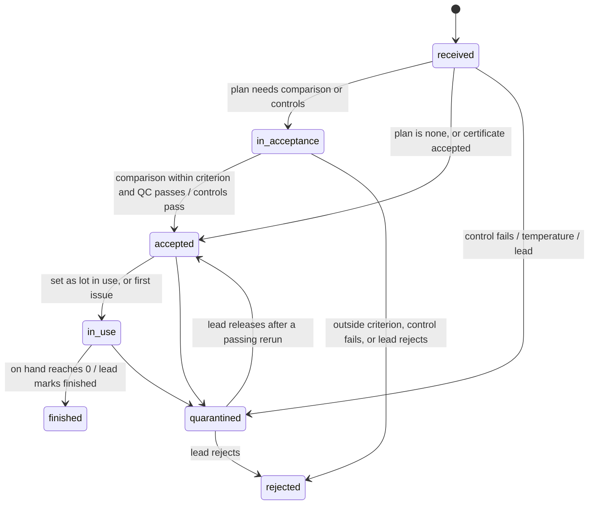
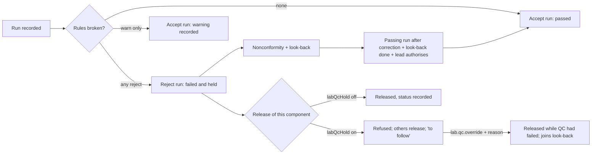
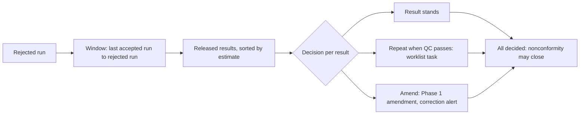

# Lab Phase 3: GATE A proposal

Written 13 Oct 2026 for Fadhul (owner and CSO). It covers `PROMPT-LAB-PHASE-3.md` (registers, reports and
quality), built on `feat/lab-quality-registers`. The facts it rests on are in `STOP-REPORTS.md` (STOP 0); the
canvas inventory is in `ui-canvas-notes.md`; the hazard log is in `hazard-log.md`.

**How this gate was passed.** The owner told the build session to go through every step using Claude's
recommendations (13 Oct 2026). So every decision below is recorded as "accepted as recommended", and the build
goes ahead. That instruction covers design decisions only. It signs **no clinical value and no clinical wording**:

- every QC plan, target, SD, rule set, acceptance criterion, kit and stain rule, stain pass criterion, device rule,
  competency validity, stock level, temperature range and the HMIS mapping lands as a **draft in the product**,
  signed later by the laboratory lead (and the CSO or the HMIS focal person where §4 says);
- every string in Appendix A is `draft` in `content/lab-phase-3.ts`, so all eight flags stay off in production
  until the CSO signs it (the copy gate in `workspaceLiveFor`);
- the HMIS form version is the research transcription, marked unverified until checked against eHMIS (OA-1);
- migrations are written, never applied; the owner applies them.

Principle (the owner's "ponytail" instruction): the smallest design that meets every law. Where the prompt lists
several tables and one existing table or pattern already does the job, this proposal reuses it and says so in §1.

---

## 1. Where this proposal differs from the prompt (and why)

| #   | Prompt says                                                                                                                                      | Built instead                                                                                                                                                                                                                                                                                                                | Why                                                                                                                    |
| --- | ------------------------------------------------------------------------------------------------------------------------------------------------ | ---------------------------------------------------------------------------------------------------------------------------------------------------------------------------------------------------------------------------------------------------------------------------------------------------------------------------- | ---------------------------------------------------------------------------------------------------------------------- |
| P1  | Separate signed tables: `qc_plans`, `acceptance_plans`, `kit_qc_rules`, `stain_criteria`, `device_qc_rules`, `hmis_mappings`, `register_configs` | **New kinds in Phase 2's `lab_signed_configs`**: `qc_plan`, `qc_policy`, `kit_qc_rule` (stain pass criteria inside it), `acceptance_plan`, `device_qc_rule`, `competency_validity`, `hmis_mapping`, `register_config`, each with a Zod payload (§3.1)                                                                        | One signing path, one freeze trigger, one sign-off screen, versioning and supersession already built and tested        |
| P2  | `equipment_ext` keyed to the hub's machine                                                                                                       | **The hub has no machine record** (STOP 0, H5). The machine record is the existing `devices` table (bedside meters already live there), widened with analyser and lab-equipment kinds and service details. Status reaches ordering **through the hub's own action** (`ha-services-hub` `report_problem` / `resolve_problem`) | One machine table for bench and bedside; the hub keeps owning availability, so OM-2 follows by itself (Law 2)          |
| P3  | `maintenance_schedules`, `maintenance_tasks`, `calibration_items`, `calibration_records`, `temperature_points`, `temperature_readings`           | Schedules, calibration items and temperature range as JSON on the device (operational, set by the lead); **one append-only `lab_equipment_logs`** (kind: maintenance, calibration, temperature, repair, error, drop)                                                                                                         | Six tables become one log and one column                                                                               |
| P4  | `qc_materials`, `qc_material_lots`                                                                                                               | A control material is a stock item of kind `control`; its lot is a stock lot. The maker's printed range for that lot is the lot's `insert_ranges` (also used for bedside strip-lot control ranges, BQ-1)                                                                                                                     | Lots live in one ledger (Law 2); a control lot needs acceptance and FEFO like any other                                |
| P5  | `qc_runs`, `qc_run_values`, `qc_rule_breaks`, `qc_decisions`                                                                                     | **One append-only `lab_qc_runs` row** per run: values per level, rule breaks and the decision as JSON                                                                                                                                                                                                                        | The run is evaluated and decided in one action (the chart decides, the person confirms); nothing is updated afterwards |
| P6  | `kit_qc_events`, `device_qc_checks`                                                                                                              | **One append-only `lab_control_checks`** (subject: kit, stain or device)                                                                                                                                                                                                                                                     | Same shape (expected answer or range, observed, pass or fail); RLS still lets a nurse see only her ward's device rows  |
| P7  | `lookbacks`, `lookback_items`, `nonconformities`, `nc_actions`, `nc_links`                                                                       | `lab_nonconformities`, append-only `lab_nc_events` (actions, links, notifications, resumption, closure) and `lab_lookback_items` (the look-back belongs to its nonconformity, NC-3)                                                                                                                                          | A look-back without a nonconformity never exists; actions and links are events                                         |
| P8  | `eqa_schemes`, `eqa_enrolments`, `eqa_rounds`, `eqa_samples`, `eqa_results`, `eqa_reports`, `alt_assessments`                                    | `lab_eqa_schemes` (covered tests as a list = enrolment), `lab_eqa_rounds` (samples, results and scores as JSON; the provider's report as a stored file path), `lab_alt_assessments`                                                                                                                                          | Seven tables become three                                                                                              |
| P9  | `device_qc_rules`, `device_qc_ranges`                                                                                                            | Rule as signed config kind `device_qc_rule`; ranges per strip lot as that lot's `insert_ranges` (entered by the lab from the vial)                                                                                                                                                                                           | The range belongs to the lot                                                                                           |
| P10 | `hmis_form_versions`, `hmis_rows`, `hmis_cells`                                                                                                  | **A committed data file**, `data/lab/hmis105-2019-09.json` (rows, groups, has-positive, sub-columns, eHMIS ids when obtained, every row `verified: false`)                                                                                                                                                                   | The form is national, not per hospital; a version is a file with a hash, as the CFC addendum is                        |
| P11 | `hmis_manual_cells`                                                                                                                              | Manual cells live inside the report's draft JSON and are frozen with it at signing                                                                                                                                                                                                                                           | They have no life outside one report                                                                                   |
| P12 | `deliveries`, `delivery_lines`, `stock_count_lines`                                                                                              | Lines as JSON on `lab_deliveries` and `lab_stock_counts`; every quantity that moves stock is a `lab_stock_transactions` row pointing back                                                                                                                                                                                    | Lines are immutable once saved; the ledger is the queryable fact                                                       |
| P13 | `indicator_month_cache` (optional)                                                                                                               | Not built                                                                                                                                                                                                                                                                                                                    | YAGNI: computed at read time (QI-3); add only if the p95 budget fails                                                  |
| P14 | `poct.record` becomes per test                                                                                                                   | `poct_operators` stays the grant; `lab_competencies` adds the per-test validity beside it (BQ-4)                                                                                                                                                                                                                             | `poct.record` was never a permission string (STOP 0, D1)                                                               |
| P15 | Held component not released, others released (QH-2)                                                                                              | Release is per report today. The release writes the `final` version with the held components' observations at observation status `preliminary` and the report's `qc_held` list; releasing them later writes a **completion version** (`final` after `final`, only for held components, no correction alert) (E-LAB3-08)      | No new report status that every reader would have to learn; the doctor's view already distinguishes observation status |
| P16 | `hmis.sign`, `hmis.focal` permissions                                                                                                            | A small `hmis_designations` table (role `in_charge` or `focal`, user, from, to), set by the hospital admin (E-LAB3-11)                                                                                                                                                                                                       | No such role exists (STOP 0, Q15); a designation is time-bound like `department_heads`                                 |
| P17 | 10.5 "by reason" from the availability snapshot reason                                                                                           | The snapshot gains `reason` (the hub's reason code) at placement; orders placed before carry none and count under "Others"                                                                                                                                                                                                   | The snapshot has no reason today (STOP 0, H6)                                                                          |
| P18 | 10.1 and 10.7 by specimen type (Blood, Stool, Urine, Sputum, CSF, Pus swab, Genital swab, Skin snip, Others)                                     | `specimens.specimen_type` gains `sputum`, `stool`, `csf`, `pus_swab`, `genital_swab`, `skin_snip`, `other` (E-LAB3-10); the mapping groups blood and urine types into the form's columns                                                                                                                                     | MedSync has blood and urine types only; sputum tests record `unknown` today                                            |
| P19 | Table names `stock_items`, `stock_lots`, …                                                                                                       | Prefixed `lab_` (`lab_stock_items`, `lab_stock_lots`, …)                                                                                                                                                                                                                                                                     | Pharmacy Phase 1 (unmerged) has its own stock ledger; the prefix keeps the two apart (STOP 0, D7)                      |

## 2. Decisions (all accepted as recommended, 13 Oct 2026, on the owner's instruction)

| #         | Decision                           | Accepted                                                                                                                                                                                                                                                                               |
| --------- | ---------------------------------- | -------------------------------------------------------------------------------------------------------------------------------------------------------------------------------------------------------------------------------------------------------------------------------------- |
| D-LAB3-01 | QC failure and release (CSO)       | As recommended: hold release of that analyte on that analyser while its latest run is rejected; override only by a holder of `lab.qc.override` with a reason; the doctor sees "Released while QC had failed"; the result joins the look-back                                           |
| D-LAB3-02 | QC not run in the window           | As recommended: inform by default ("QC not run today", recorded on the result); the lead may set "hold" per plan                                                                                                                                                                       |
| D-LAB3-03 | Westgard rules                     | As recommended: default reject set 1-3s, 2-2s, R-4s (within run only), 4-1s, 10-x; 1-2s a warning; editable per plan; all rules applied directly, no 1-2s gate; sigma-based selection later                                                                                            |
| D-LAB3-04 | Targets and SDs                    | As recommended: maker's range, provisional, until the signed minimum of accepted runs over the signed minimum span (defaults 20 and 20 days, held in `qc_policy` with sources WHO LQMS and CLSI C24 Ed4 via Westgard), then the lab's own by explicit action; no rolling recalculation |
| D-LAB3-05 | Levels and frequency               | As recommended: at least two levels, each day of testing before patient samples, unless the lead's risk-based plan says otherwise                                                                                                                                                      |
| D-LAB3-06 | Kit and stain QC triggers          | As recommended (WHO 2015, WHO LQMS, MM-SOP-03C, GLI); each rule signed by the lead                                                                                                                                                                                                     |
| D-LAB3-07 | Lot acceptance                     | As recommended: required before patient use for everything that affects results; reagents by patient-sample comparison (EP26), kits and stains by controls; go-live lots grandfathered with a statement                                                                                |
| D-LAB3-08 | Look-back                          | As recommended: last accepted run to the rejected run on that analyser; the bias estimate labelled and only sorts; every result decided before closure                                                                                                                                 |
| D-LAB3-09 | Stock levels                       | As recommended: min and max in months of stock per item, set by the lead; use from the last 3 months of issues; weekly count; all operational                                                                                                                                          |
| D-LAB3-10 | HMIS Section 6                     | As recommended                                                                                                                                                                                                                                                                         |
| D-LAB3-11 | Equipment down                     | As recommended, through the hub's own action (P2)                                                                                                                                                                                                                                      |
| D-LAB3-12 | Temperature                        | As recommended: out of range opens a nonconformity and suggests quarantine; never automatic                                                                                                                                                                                            |
| D-LAB3-13 | EQA                                | As recommended                                                                                                                                                                                                                                                                         |
| D-LAB3-14 | Nonconformity closure              | As recommended; nothing auto-closes                                                                                                                                                                                                                                                    |
| D-LAB3-15 | Bedside device checks              | As recommended: a failed check blocks; not done today informs unless the rule says "required before use"                                                                                                                                                                               |
| D-LAB3-16 | Bedside competency                 | As recommended: per test, assessed by the lab, validity set by the lead; lapsed refused; grace period at switch-on                                                                                                                                                                     |
| D-LAB3-17 | HMIS mapping                       | As recommended, to the 2019 print version; **signing waits for OA-1** (verification against eHMIS); signed by the lead and the HMIS focal person                                                                                                                                       |
| D-LAB3-18 | Counting rules                     | As recommended: HM-3 (a)–(i), shown on the report, signed with the mapping                                                                                                                                                                                                             |
| D-LAB3-19 | Bedside tests in HMIS              | As recommended: counted in their row, share shown                                                                                                                                                                                                                                      |
| D-LAB3-20 | 10.1 visits                        | As recommended; to confirm with the Division of Health Information before signing                                                                                                                                                                                                      |
| D-LAB3-21 | HIV testing purpose                | As recommended: required on HIV rapid-test orders when `labHmis` is on, restricted with the test                                                                                                                                                                                       |
| D-LAB3-22 | Blank versus zero                  | As recommended                                                                                                                                                                                                                                                                         |
| D-LAB3-23 | HMIS lifecycle                     | As recommended; print and CSV only                                                                                                                                                                                                                                                     |
| D-LAB3-24 | Daily register                     | As recommended; defaults from the canvas until the register photographs (OA-3)                                                                                                                                                                                                         |
| D-LAB3-25 | A-LIS sites                        | As recommended: all eight flags off                                                                                                                                                                                                                                                    |
| D-LAB3-26 | Who sees reports                   | As recommended                                                                                                                                                                                                                                                                         |
| D-LAB3-27 | Rollout order                      | As recommended (§13)                                                                                                                                                                                                                                                                   |
| E-LAB3-01 | Stock ledger                       | As recommended: append-only; on hand derived                                                                                                                                                                                                                                           |
| E-LAB3-02 | Bedside lots                       | As recommended: `poct_lots` rows move into `lab_stock_lots` keeping their ids (§7)                                                                                                                                                                                                     |
| E-LAB3-03 | QC rules                           | As recommended: a pure evaluator in SD units, rule library as data                                                                                                                                                                                                                     |
| E-LAB3-04 | QC status                          | As recommended: a cached row per device × component                                                                                                                                                                                                                                    |
| E-LAB3-05 | HMIS                               | As recommended, with the form version as a data file (P10)                                                                                                                                                                                                                             |
| E-LAB3-06 | Indicators                         | As recommended; no month cache (P13)                                                                                                                                                                                                                                                   |
| E-LAB3-07 | Nonconformities                    | As recommended: a generic engine (`source` and `subject` are open text keys, so microbiology and blood bank reuse it)                                                                                                                                                                  |
| E-LAB3-08 | Partial release (new, P15)         | Held components stay `preliminary` inside a `final` report, listed in `qc_held`; a completion version releases them                                                                                                                                                                    |
| E-LAB3-09 | Machine record (new, P2)           | `devices` widened; `analyser_profiles.device_id` links a profile to its analyser                                                                                                                                                                                                       |
| E-LAB3-10 | Specimen types (new, P18)          | Seven types added; the catalogue's sputum, stool and swab tests are given their type in the same migration                                                                                                                                                                             |
| E-LAB3-11 | HMIS designations (new, P16)       | `hmis_designations`, set by the hospital admin                                                                                                                                                                                                                                         |
| E-LAB3-12 | Lead-only signed kinds (new, §3.1) | Kinds the prompt has signed by the laboratory lead alone need only the lead's signature; `qc_plan` and `qc_policy` need the lead and the CSO; `hmis_mapping` needs the lead and the HMIS focal person                                                                                  |

## 3. Schema diff (migrations 0112–0117; additive; GATED, owner-applied)

### 3.1 Signed configuration: new kinds (0112)

The kind CHECK on `lab_signed_configs` is replaced (new list below), and `lsc_signed_by_two` becomes:
`status = 'draft' OR (lead_signed_by IS NOT NULL AND in_force_from IS NOT NULL AND (kind IN ('kit_qc_rule',
'acceptance_plan','device_qc_rule','competency_validity','register_config') OR (cso_signed_by IS NOT NULL AND
(lead_signed_by <> cso_signed_by OR exception_note IS NOT NULL))))`. The second slot (`cso_signed_by`) is the
CSO for `qc_plan` and `qc_policy`, and the **HMIS focal person** for `hmis_mapping` (the action checks the
designation; the column name stays, as `ncd_mapping`'s lead slot already holds the registry lead). Every new kind is
added in the six places STOP 0 found (`PAYLOADS`, `KIND_WORDS`, the readers, the CSO sign-off page, fixtures).

| Kind                  | Key                         | Payload (Zod; no value is ever defaulted in code)                                                                                                                                                                                                                                            | Signers      |
| --------------------- | --------------------------- | -------------------------------------------------------------------------------------------------------------------------------------------------------------------------------------------------------------------------------------------------------------------------------------------- | ------------ |
| `qc_policy`           | `hospital`                  | `{minRunsForTarget, minDaysForTarget, sources[]}`                                                                                                                                                                                                                                            | lead + CSO   |
| `qc_plan`             | `{deviceId}:{conceptId}`    | `{levels:[{level, label, controlItemId}], frequency:{kind:"each_day_before_patients"\|"per_run"\|"per_n_samples", n?}, rejectRules[], warnRules[], tenXAcrossLevels, holdWhenNotRun, targets:[{level, controlLotId, mean, sd, source:"maker_provisional"\|"lab", runs?, from?, to?}], unit}` | lead + CSO   |
| `kit_qc_rule`         | `{stockItemId}`             | `{triggers:[{kind, weekday?}], controls:[{name, expected:{code}\|{passCriteria:[text]}}], requiredBeforeUse, hmisIqc, source}`                                                                                                                                                               | lead         |
| `acceptance_plan`     | `{stockItemId}`             | `{method:"qc_pass"\|"lot_comparison"\|"certificate"\|"none", triggers[], comparison?:{samples, spread, criterion:{absolute?, percent?, combine:"larger"\|"both"}, qcAlso}, certificateAllowed, source}`                                                                                      | lead         |
| `device_qc_rule`      | `{testCode}`                | `{triggers[], levels[], requiredBeforeUse}` (ranges come from each strip lot)                                                                                                                                                                                                                | lead         |
| `competency_validity` | `{testCode}`                | `{methods[], validDays, graceDays}`                                                                                                                                                                                                                                                          | lead         |
| `hmis_mapping`        | `2019-09-print`             | `{formHash, orgUnitCode, rows:[{code, sources:[{testCode, conceptId?, answers?}], positive?:{conceptId, answers[]}, sub?}], specimenColumns:{[type]:column}, rejection:{[code]:row}, reasons:{[hubReason]:column}, tracers:{[stockItemId]:row}, visitsDefinition, countingRules[]}`          | lead + focal |
| `register_config`     | `general` \| `hiv` \| class | `{columns:[{key, label}], sections[]}`                                                                                                                                                                                                                                                       | lead         |

Operational settings (labelled operational, never clinical; set by the lead, audited, not signed): one
`quality jsonb` column on `lab_settings` holding the expiry alert window, consumption look-back months, count
frequency, ST-9 tolerance, EQA tester window and alternative-assessment period. Stock levels sit on each item.

### 3.2 Tables and columns

**0112 `lab_stock`**

- `lab_stock_items`: `id, hospital_id, name, kind (reagent|kit|control|calibrator|stain|consumable|strip),
unit_of_issue, pack_size, tests_per_unit numeric NULL, test_codes text[], concept_ids text[], storage_device_id
NULL → devices, hmis_tracer_code NULL, min_months NULL, max_months NULL, active, created_by/at, updated_by/at`.
- `lab_stock_lots`: `id, hospital_id, item_id, lot, use_by date NULL, received_at, condition jsonb, opened_at NULL,
state (received|in_acceptance|accepted|in_use|finished|quarantined|rejected), accepted_basis
(plan|qc|certificate|none|before_medsync) NULL, statement NULL, insert_ranges jsonb NULL`; `UNIQUE (item_id, lot)`.
  `expired` is not stored: it is the clock's verdict at the end of the use-by day, hospital-local (ST-2, ST-8).
- `lab_stock_lot_events` (append-only): `lot_id, hospital_id, from_state, to_state, reason, ref_kind, ref_id,
actor (NULL = MedSync), at`. A trigger allows a lot's `state` to change only with a matching event in the same
  transaction and only along §5.1.
- `lab_stock_transactions` (append-only): `id, hospital_id, item_id, lot_id NULL, kind
(receipt|issue|adjustment|count|write_off|return), quantity integer (signed, units of issue), to_kind
(bench|device|ward) NULL, to_ref NULL, reason NULL, fefo_reason NULL, delivery_id NULL, count_id NULL, actor, at,
client_key`.
- `lab_deliveries`: `id, hospital_id, supplier (nms|jms|other), supplier_name, note_number, received_at,
received_by, lines jsonb` (`[{itemId, lotId, received, accepted, rejected, condition, next}]`), immutable once
  saved.
- `lab_stock_counts`: `id, hospital_id, counted_at, counted_by, lines jsonb` (`[{itemId, lotId, expected, counted,
reason}]`), immutable.
- `lab_lot_acceptances` (append-only): `id, hospital_id, lot_id, plan_config_id, plan_version, method, pairs jsonb
([{observationId, level, current, candidate}]), qc_check_ids uuid[], certificate_path NULL, outcome
(accepted|rejected), reason, decided_by, decided_at`.
- `lab_lots_in_use` (append-only): `id, hospital_id, device_id NULL, section_id NULL, concept_id NULL, kind
(reagent|calibrator|control|strip|kit), lot_id, from_at, set_by`. Current = newest row per (device or section,
  concept, kind).
- **`poct_lots` → `lab_stock_lots`** (§7).
- `lab_result_snapshots` + `lots jsonb` (reagent, calibrator, control lot ids and numbers, or `"not_recorded"`),
  `qc jsonb` (`{status, runId, override?}`).
- `lab_settings` + `quality jsonb`.
- `lab_signed_configs`: kinds and check (§3.1).

**0113 `lab_equipment`**

- `devices`: kind CHECK + `analyser, centrifuge, fridge, freezer, incubator, water_bath, microscope, pipette,
thermometer, timer, safety_cabinet, other`; state CHECK + `down, blocked`; new columns `section_id NULL →
hospital_departments, details jsonb (model notes, location, service provider and contact, installed on),
linked_concepts text[], linked_tests text[], schedules jsonb (maintenance tasks, calibration items, temperature
range and readings per day)`.
- `analyser_profiles` + `device_id NULL → devices` (E-LAB3-09).
- `lab_equipment_logs` (append-only): `id, hospital_id, device_id, kind (maintenance|calibration|temperature|repair|
error|drop), task_key NULL, value numeric NULL, unit NULL, in_range boolean NULL, note NULL, file_path NULL,
done_at, actor, at, client_key`.
- `lab_breakdowns`: `id, hospital_id, device_id, since, cause, reported_to, ticket, hub_problem_ids uuid[],
specimens_to_refer integer, repair_log_id NULL, back_at NULL, back_by NULL, downtime_minutes NULL`; the closing
  fields may be set once (trigger).

**0114 `lab_qc`**

- `lab_qc_runs` (append-only): `id, hospital_id, device_id, concept_id, plan_config_id, plan_version, values jsonb
([{level, lotId, value, z}]), breaks jsonb ([{rule, kind, scope, level?, runIds}]), decision
(accepted|warning|rejected), first_step NULL, note NULL, run_at, recorded_by, client_key`.
- `lab_qc_status` (cache, PK `(hospital_id, device_id, concept_id)`): `status (passed|warning|failed|
provisional_target), run_id, plan_config_id, held boolean, updated_at`. `no_plan` and `not_run_in_window` are
  computed when no row or no run in the window exists.
- `lab_control_checks` (append-only): `id, hospital_id, subject (kit|stain|device), item_id NULL, lot_id NULL,
device_id NULL, trigger, controls jsonb ([{name, expected, observed, pass}]), outcome (pass|fail), hmis_iqc
boolean, operator, at, client_key`.
- `lab_nonconformities`: `id, hospital_id, number (NC-YYYY-NNN), source (qc_reject|kit_qc_fail|eqa_unacceptable|
temperature|lot_rejected|equipment|complaint|specimen|other), source_ref, subject_device_id NULL,
subject_concept_id NULL, title, what_happened, risk_text, testing_halted, owner, state (open|closed),
cause_category NULL, effectiveness_plan NULL, effectiveness_met NULL, opened_at, opened_by NULL (MedSync),
resumed_at/by NULL, closed_at/by NULL`; fields after opening change only through `lab_nc_events`.
- `lab_nc_events` (append-only): `nc_id, hospital_id, kind (action_added|action_updated|linked|notified|resumed|
closed|note), payload jsonb, actor NULL, at`.
- `lab_lookback_items`: `id, nc_id, hospital_id, patient_user_id, report_id, observation_id, released_at, value,
sort (flag_might_change|critical_nearby|unchanged), decision NULL (stands|repeat|amend), decided_by/at NULL,
amendment_report_id NULL`; the decision is set once (trigger).
- `diagnostic_reports` + `qc_held text[] NULL` (E-LAB3-08).

**0115 `lab_eqa`**

- `lab_eqa_schemes`: `id, hospital_id, name, provider, covers text[] (test codes), rounds_per_year, active`.
- `lab_eqa_rounds`: `id, hospital_id, scheme_id, label, received_on, due_on, submitted_on NULL, tested_by uuid[],
samples jsonb ([{sampleId, conceptId, ours, target?, score?, scoreKind?, limit?}]), report_path NULL, outcome
NULL (acceptable|unacceptable|mixed), nc_id NULL`.
- `lab_alt_assessments`: `id, hospital_id, test_code, method (split_sample|interlab|retained_samples), partner NULL,
done_on, results jsonb, conclusion, recorded_by`.

**0116 `lab_bedside_quality`**

- `lab_competencies` (append-only; a reassessment is a new row): `id, hospital_id, user_id, test_code,
assessed_on, assessor NULL, method[], valid_to, grandfathered boolean, revoked_at NULL, revoked_by NULL`.
- Device state `blocked` (in 0113's CHECK); set by a failed check, cleared by a passing one.

**0117 `lab_registers_hmis`**

- `lab_register_prints` (append-only): `id, hospital_id, register (general|hiv|class), section_id NULL, day,
pages, config_id, config_version, printed_by, printed_at`.
- `lab_hmis_reports`: `id, hospital_id, month, revision, state (draft|checked|signed|exported), mapping_config_id,
mapping_version, form_hash, cells jsonb, sources jsonb (record ids per cell), manual jsonb, checked_by/at,
signed_by/at, exported_by/at`; unique `(hospital_id, month, revision)`; once `signed`, only `exported_*` may be set
  (trigger).
- `hmis_designations`: `id, hospital_id, role (in_charge|focal), user_id, starts_on, ends_on NULL, set_by, set_at`.
- `encounter_orders` + `test_purpose text NULL CHECK (hct|emtct|clinical_diagnosis|smc|verification|recency)`.
- `specimens.specimen_type` CHECK + seven types (E-LAB3-10); `test_catalogue` rows for `test.sputum_afb`,
  `test.tb_xpert` take `sputum`.
- `encounter_orders.availability_snapshot` gains `reason` in the writer (no migration; it is JSON).

**Data file:** `data/lab/hmis105-2019-09.json` (§8.1).

**Final table list (new):** `lab_stock_items`, `lab_stock_lots`, `lab_stock_lot_events`, `lab_stock_transactions`,
`lab_deliveries`, `lab_stock_counts`, `lab_lot_acceptances`, `lab_lots_in_use`, `lab_equipment_logs`,
`lab_breakdowns`, `lab_qc_runs`, `lab_qc_status`, `lab_control_checks`, `lab_nonconformities`, `lab_nc_events`,
`lab_lookback_items`, `lab_eqa_schemes`, `lab_eqa_rounds`, `lab_alt_assessments`, `lab_competencies`,
`lab_register_prints`, `lab_hmis_reports`, `hmis_designations` (23, against about 50 in the prompt). Changed:
`lab_signed_configs`, `devices`, `analyser_profiles`, `lab_result_snapshots`, `lab_settings`, `diagnostic_reports`,
`encounter_orders`, `specimens`, `test_catalogue` rows, `poct_lots` (frozen).

## 4. Permissions and designations

`LAB_PERMISSIONS` (`lib/lab/access.ts:15-22`) gains five. None needs a new store:

| Permission         | Derived from                                                                                                                                    | Lets you                                                                         |
| ------------------ | ----------------------------------------------------------------------------------------------------------------------------------------------- | -------------------------------------------------------------------------------- |
| `lab.qc.override`  | An open `department_heads` row for LABORATORY or the section (substantive **or acting**: the acting head is the "delegate named for the shift") | Release past a QC hold with a reason                                             |
| `lab.stock.manage` | Cadre map: `LAB_TECH`, `LAB_TECHNOLOGIST` (next version of `data/lab/permission-map.v1.json`, CSO signs)                                        | Receive, issue, count, write off; quarantine. Levels and plans need `lab.manage` |
| `lab.eqa.manage`   | As `lab.manage`                                                                                                                                 | Schemes, rounds, scores, alternative assessments                                 |
| `lab.hmis.check`   | As `lab.manage`                                                                                                                                 | Check the HMIS 105; save manual cells; sign the mapping's lead slot              |
| `poct.assess`      | Cadre map: `LAB_TECH`, `LAB_TECHNOLOGIST`                                                                                                       | Record a competency assessment                                                   |

**HMIS roles.** `hmis.sign` and `hmis.focal` are not lab permissions: they come from an open `hmis_designations` row
(`in_charge`, `focal`) at the hospital, set by the hospital admin (assignment audited). The In-Charge signs from a
small page `/hmis/[month]` with its own scope helper (AAL2, the designation, a fresh second factor at signing via
`secondFactorFresh()`); it shows aggregates only, with no drill-down unless the person also holds a lab role.

**"Users with HIV access"** (DR-3) = lab staff of the hospital holding `lab.result.release` (they already release HIV
results). Other restricted classes print only on their class register, under the same rule.

**Bedside device checks** are recorded by a granted bedside operator with a valid competency for the device's test.

**Hub status.** Marking an analyser down calls `ha-services-hub` `report_problem` with the caller's own session
(through `callEdge`), so the hub's role check applies: the caller must be a hospital admin or a current department
head. In practice the laboratory lead or the acting lead marks a machine down (hazard 14 residual).

## 5. State machines and flows

### 5.1 Lot

`expired` overlays every state at the end of the use-by day (hospital-local). **Selectable for patients** = state
`accepted` or `in_use`, not expired. Everything else is refused on the server (LA-4) at the bench (lots in use),
the analyser and the bedside form.

| Example (fixture)                                    | Path                                                                                                                  |
| ---------------------------------------------------- | --------------------------------------------------------------------------------------------------------------------- |
| A new reagent lot with a `lot_comparison` plan       | received → in_acceptance (5 pairs recorded) → accepted (all within the plan's criterion, QC passed) → in_use          |
| The same with one pair outside the criterion         | in_acceptance → rejected ("Accept lot" disabled; "Reject lot" records the reason) (S3)                                |
| A Determine lot with a `qc_pass` plan                | received → in_acceptance → accepted when both controls give the expected answer (KQ-4); a failure → quarantined (S25) |
| Gloves (`none`)                                      | received → accepted                                                                                                   |
| A strip lot on hand when `labStock` is switched on   | accepted, basis `before_medsync`, with the lead's statement (LA-6, S10)                                               |
| A lot with use-by 13 OCT, at 00:01 on 14 OCT Kampala | still `in_use` in the table, shown "Expired", cannot be issued or selected (S6)                                       |

### 5.2 QC run, decision and hold

| Step | What happens                                                                                                                                                             | Who            |
| ---- | ------------------------------------------------------------------------------------------------------------------------------------------------------------------------ | -------------- |
| 1    | Technologist types each level's result; `z = (value − target) ÷ SD` per level, from the plan version in force and the control lot's target                               | Technologist   |
| 2    | `evaluateRules(plan, run, history)` (pure) lists breaks; history = same control lot, same plan version (QR-3)                                                            | MedSync        |
| 3    | No break → **Accept run** → status `passed` (or `provisional_target` while targets are the maker's)                                                                      | Technologist   |
| 4    | Warn rule only → "Warning: accepted" → **Accept run** → status `warning` (the warning is recorded)                                                                       | Technologist   |
| 5    | Any reject rule → the run **cannot be accepted**; the decision block names the rules and their meaning; **Reject run and hold {analyte}** with the first corrective step | Technologist   |
| 6    | On reject, one transaction: run row, status `failed` and `held`, nonconformity opened (owner: lead), look-back items listed (LB-1), action "Hold release" by MedSync     | MedSync        |
| 7    | Release of that component from that device: refused while `held` with `labQcHold` on (QH-2); other components release, held ones stay preliminary (E-LAB3-08)            | Server         |
| 8    | Corrective action, then a new run. A passing run after the rejection is the first resumption condition                                                                   | Technologist   |
| 9    | **Authorise resumption** (lead): needs a passing run after the rejected one and the look-back finished; clears `held`                                                    | Lead           |
| 10   | `not_run_in_window`: informs ("QC not run today", recorded on the result) unless the plan says hold (QH-3)                                                               | Server         |
| 11   | Override: `lab.qc.override` holder, reason required; the result carries the signed line and joins the look-back; audited (QH-4)                                          | Lead or acting |

Worked example (fixture, in SD units): level 1 history `+0.3, −0.5, +2.1`; today level 1 `+2.3`, level 2 `+0.4`.
Breaks: 1-2s (warn) on level 1; 2-2s across runs on level 1 (reject). Decision: rejected; status failed; held.
Releasing the patient's potassium is refused; sodium, urea and creatinine release; the doctor sees "Potassium to
follow: held for quality control".

### 5.3 Look-back

| Step | Rule | What happens                                                                                                                                                                                  |
| ---- | ---- | --------------------------------------------------------------------------------------------------------------------------------------------------------------------------------------------- |
| 1    | LB-1 | Window: from the last accepted run's time to the rejected run's time, same device and component; results released in the window (downtime results by form time; overrides always included)    |
| 2    | LB-2 | Estimated bias = mean z of the failed level's breaking points × that level's SD, in the component's unit, labelled **estimate**                                                               |
| 3    | LB-2 | `flag_might_change` if value − bias crosses a signed range limit; `critical_nearby` if it crosses or comes within the bias of a signed critical limit; else `unchanged`. Sorted in that order |
| 4    | LB-3 | Each item: **Result stands**, **Repeat when QC passes** (a repeat task on the worklist once the status is not failed) or **Amend** (Phase 1 amendment with correction alerts, CA-10)          |
| 5    | LB-4 | "{n} of {m} reviewed"; the nonconformity cannot close while any item is undecided                                                                                                             |

Worked example (fixture): SD 0.10 units, breaking z values +2.1 and +2.3 → bias +0.22 units (estimate). A result of
5.10 with a fixture upper limit 5.00 → 5.10 − 0.22 = 4.88 crosses the limit → `flag_might_change`, listed first.

### 5.4 Nonconformity

```mermaid
stateDiagram-v2
  [*] --> open_halted: automatic (QC reject, kit fail, EQA, temperature, lot rejected) with testing halted
  [*] --> open: manual or not halting
  open_halted --> open: Authorise resumption (lead; conditions met)
  open --> closed: Close (cause, every look-back decided, actions done or cancelled, effectiveness met, lead signs)
```

| Example (fixture)                | Opened by | Halted | Resumes when                                    | Closes when                                                      |
| -------------------------------- | --------- | ------ | ----------------------------------------------- | ---------------------------------------------------------------- |
| QC 2-2s on potassium, analyser 1 | MedSync   | yes    | a passing run after correction + look-back done | cause "Calibration", 14 of 14 decided, effectiveness met, signed |
| Fridge read outside range        | MedSync   | no     | —                                               | stored lots reviewed (quarantined or kept with a reason), signed |
| EQA potassium unacceptable       | MedSync   | no     | —                                               | look-back over the round period decided, cause, effectiveness    |
| Complaint from a ward            | Lab user  | no     | —                                               | as any                                                           |

### 5.5 Equipment

| Action          | Needs                                                                                       | Writes                                                                                                                                                    |
| --------------- | ------------------------------------------------------------------------------------------- | --------------------------------------------------------------------------------------------------------------------------------------------------------- |
| Mark down       | `lab.manage` (and the hub's head check)                                                     | breakdown row; device `down`; for each linked test whose only in-service analyser this is, hub `report_problem` (subject `test`, reason `equipment_down`) |
| Record repair   | `lab.manage` or `lab.result.release`                                                        | `lab_equipment_logs` kind `repair`                                                                                                                        |
| Back in service | a repair log after `since`, and an accepted run after the repair for every linked component | device `in_use`; hub `resolve_problem` for each problem; downtime minutes                                                                                 |

### 5.6 HMIS report

`draft` (generated, manual cells editable) → `checked` (lead) → `signed` (In-Charge, fresh factor; cells, sources and
mapping version frozen) → `exported`. A nightly job and every view compare the frozen cells with a fresh count;
differences show **Changed since signing**; **Prepare revision** creates revision n+1 in `draft`. Old revisions stay
readable.

## 6. The Westgard rule library (QR-1, QR-2), with a worked example per rule

All rules work on `z = (value − target) ÷ SD`, per level, with the plan version's target for that control lot.
"Exceeds +2s" means `z > 2` strictly (a point at exactly 2.00 breaks nothing); "one side of the mean" means `z > 0`
or `z < 0` (a point at exactly 0 ends a run). History for across-run rules is the same control lot and plan version
only (QR-3). Examples are fixtures in SD units, never values.

| Rule    | Kind (default)           | Scope                                                                  | Breaks when                                            | Worked example (fixture z)                                                                                                               |
| ------- | ------------------------ | ---------------------------------------------------------------------- | ------------------------------------------------------ | ---------------------------------------------------------------------------------------------------------------------------------------- |
| 1-2s    | warning                  | one point                                                              | any point `abs(z) > 2`                                 | L1 `+2.3`, L2 `+0.4` → warning only; the run is accepted with the warning recorded                                                       |
| 1-3s    | reject                   | one point                                                              | any point `abs(z) > 3`                                 | L1 `+3.2` → reject                                                                                                                       |
| 2-2s    | reject                   | within run across levels; and within one level across consecutive runs | two points beyond the **same** 2s limit                | within: L1 `+2.2`, L2 `+2.4` → reject. across: yesterday L1 `+2.1`, today L1 `+2.3` → reject. L1 `+2.2`, L2 `−2.4` → not 2-2s (see R-4s) |
| R-4s    | reject                   | **within run only**                                                    | one point `z > 2` and another `z < −2` in the same run | L1 `+2.1`, L2 `−2.2` → reject. Yesterday L1 `+2.1`, today L1 `−2.2` → **not** R-4s (two 1-2s warnings)                                   |
| 4-1s    | reject                   | across runs within a level (and across levels if the plan says)        | four consecutive points beyond the same 1s limit       | L1 last four `+1.2, +1.4, +1.1, +1.3` → reject; `+1.2, +1.4, +0.9, +1.3` → no                                                            |
| 10-x    | reject                   | across runs; across levels if `tenXAcrossLevels`                       | ten consecutive points on one side of the mean         | L1 last ten all between `+0.1` and `+0.9` → reject; one at `0.0` resets the count                                                        |
| 2of3-2s | optional (3-level plans) | within run across three levels                                         | two of three points beyond the same 2s limit           | L1 `+2.2`, L2 `+0.5`, L3 `+2.1` → reject                                                                                                 |
| 3-1s    | optional (3-level plans) | across levels or runs                                                  | three consecutive points beyond the same 1s limit      | L1 `+1.1`, L2 `+1.4`, L3 `+1.2` → reject                                                                                                 |
| 6-x     | optional                 | across runs                                                            | six consecutive on one side                            | six positives → reject                                                                                                                   |
| 8-x     | optional                 | across runs                                                            | eight consecutive on one side                          | eight positives → reject                                                                                                                 |
| 9-x     | optional                 | across runs                                                            | nine consecutive on one side                           | nine negatives → reject                                                                                                                  |
| 12-x    | optional                 | across runs                                                            | twelve consecutive on one side                         | twelve positives → reject                                                                                                                |

A computer evaluation applies every configured rule directly; 1-2s is never a gate (Westgard). Rule meanings shown
to the technologist ("2-2s: a systematic shift is likely") are a signed text table in `content/lab-phase-3.ts`
(Appendix A "Rule meanings", draft), checked by the lead against westgard.com. QR-4 table tests: each rule broken
alone; combinations (2-2s with 4-1s, the canvas's case); R-4s never across runs; 10-x across runs; the boundary
`z = 2.00`; a control lot change resetting history.

## 7. Moving `poct_lots` into the stock ledger (E-LAB3-02)

1. **0112 creates** `lab_stock_items` and `lab_stock_lots`.
2. **One item per bedside device test** that has lots: `INSERT INTO lab_stock_items (hospital_id, name, kind,
unit_of_issue, test_codes)` from `SELECT DISTINCT d.hospital_id, d.test_code` of devices with `poct_lots`, kind
   `strip` (meters) or `kit` (RDTs), name "{test} strips (from Phase 2)". The lead renames and sets packs later.
3. **Every lot, same id**: `INSERT INTO lab_stock_lots (id, hospital_id, item_id, lot, use_by, received_at, state,
accepted_basis, statement) SELECT p.id, p.hospital_id, <item>, p.lot, p.use_by, p.added_at, 'in_use',
'before_medsync', 'Recorded as a bedside lot in Phase 2 before stock and acceptance existed.' FROM poct_lots p`,
   plus one `lab_stock_lot_events` row each (from NULL to `in_use`, actor NULL) and one `lab_lots_in_use` row (device,
   kind `strip`/`kit`, the lot).
4. **Repoint the foreign key**: drop `diagnostic_reports_lot_id_fkey` (→ `poct_lots`), add it → `lab_stock_lots`.
   Ids are unchanged, so no report row is touched. `dr_bedside_lot` (both or neither) stays.
5. **`poct_lots` is kept**, frozen (it is already append-only), unread by code after Step 4.
6. **Count check** (STOP 2): `count(poct_lots) = count(lab_stock_lots WHERE accepted_basis = 'before_medsync' AND
id IN (SELECT id FROM poct_lots))`, and every `diagnostic_reports.lot_id` resolves.
7. **Reverse plan**: drop the new foreign key, re-add the old one to `poct_lots` (every id still exists there),
   point the bedside readers back. No data is lost either way.

## 8. HMIS 105

### 8.1 The form version (data file)

`data/lab/hmis105-2019-09.json`: `{version: "2019-09-print", source: <research link>, verified: false, sections:
[{id: "10.1"…"10.7", "6"}], rows: [{code, label, section, group, hasPositive: null, sub?: ["MTB+","RR"], cells:
[{column, dataElement: null, categoryOption: null}], verified: false, note: "unverified (research, text extraction)"}]}`.
`hasPositive` is `null` (unknown) for every 10.2 row until OA-1: the report shows a dash only where the verified
form has no positive column; until then a positive count is shown with "positive column not verified". Its SHA-256
is stored on each mapping and each report.

### 8.2 The mapping, row by row (proposal for the lead and the focal person; nothing signed)

Every row of the research transcription, with the proposed source. "No test" = no orderable in-house test today:
the row is **blank** at a hospital (HM-3 i) unless a later test maps to it. Positive answers are the concepts' live
answer codes.

**10.1 Visits and specimens.** LV01 OPD and LV02 IPD: distinct patient × hospital-local day × encounter type
(`opd`, `emergency`, `follow_up`, `tele` → OPD; `inpatient` → IPD) with a specimen received, by specimen column
(D-LAB3-20, to confirm with the Division of Health Information). SC01 Collected (in), SC02 Received (out): definitions
not verified (OA-1); proposed SC01 = specimens collected here, SC02 = specimens received from elsewhere (none until
referral-in exists, Phase 4). Columns: Blood ← `venous_*`, `capillary_whole_blood`, `arterial_blood`; Urine ←
`urine_*`; Sputum, Stool/Rectal swab, CSF, Pus swab, Genital swab, Skin snip ← the new types (E-LAB3-10); Others ←
`interstitial_fluid`, `other`, `unknown`.

**10.2 Routine tests** (number done = released component or test results per HM-3; number positive per the rule):

| Row       | Label (transcribed)      | Source (test → component)                                                                                                                                                                                                                                                                                              | Positive rule                                                                |
| --------- | ------------------------ | ---------------------------------------------------------------------------------------------------------------------------------------------------------------------------------------------------------------------------------------------------------------------------------------------------------------------- | ---------------------------------------------------------------------------- |
| HE01      | Hb (Non automated)       | No test (FBC's haemoglobin counts under HE02)                                                                                                                                                                                                                                                                          | —                                                                            |
| HE02      | CBC                      | `test.fbc` (one per test)                                                                                                                                                                                                                                                                                              | —                                                                            |
| HE03      | Film Comment             | No test                                                                                                                                                                                                                                                                                                                | —                                                                            |
| HE04      | ESR                      | `test.esr`                                                                                                                                                                                                                                                                                                             | —                                                                            |
| HE05      | Bleeding time            | No test                                                                                                                                                                                                                                                                                                                | —                                                                            |
| HE06      | Prothrombin time         | `test.inr_pt`; `test.coag_screen` → `obs.pt`                                                                                                                                                                                                                                                                           | —                                                                            |
| HE07      | Clotting time            | No test                                                                                                                                                                                                                                                                                                                | —                                                                            |
| HE08      | Sickle Cell              | No test                                                                                                                                                                                                                                                                                                                | —                                                                            |
| HE09      | Others                   | Explicit: `test.coag_screen` → `obs.aptt`; `test.d_dimer` (the canvas put D-dimer under CX07: the lead chooses)                                                                                                                                                                                                        | —                                                                            |
| BT01      | AHG (Comb's Test)        | No test                                                                                                                                                                                                                                                                                                                | —                                                                            |
| BT02      | ABO Grouping             | `test.blood_group` → `obs.abo_group`                                                                                                                                                                                                                                                                                   | —                                                                            |
| BT03      | Rhesus Grouping          | `test.blood_group` → `obs.rhd_type`                                                                                                                                                                                                                                                                                    | —                                                                            |
| BT04      | Cross Matching           | No test (blood bank, Phase 4+)                                                                                                                                                                                                                                                                                         | —                                                                            |
| SR01      | VDRL/RPR                 | `test.rpr` → `obs.rpr_result`                                                                                                                                                                                                                                                                                          | `reactive`                                                                   |
| SR02      | TPHA                     | `test.tpha` → `obs.treponemal_lab_result`                                                                                                                                                                                                                                                                              | reactive answer                                                              |
| SR03      | Shigella Dysentery       | No test                                                                                                                                                                                                                                                                                                                | —                                                                            |
| SR04      | Hepatitis B SAgS         | `test.hbsag`                                                                                                                                                                                                                                                                                                           | `positive`                                                                   |
| SR05      | Brucella                 | No test                                                                                                                                                                                                                                                                                                                | —                                                                            |
| SR06      | Pregnancy Test (HCG)     | `test.pregnancy_urine`                                                                                                                                                                                                                                                                                                 | `positive`                                                                   |
| SR07      | CRAG                     | `test.crag` → `obs.crag`                                                                                                                                                                                                                                                                                               | `positive`                                                                   |
| SR08      | Rheumatoid factor        | No test                                                                                                                                                                                                                                                                                                                | —                                                                            |
| SR09      | Hep B Core Ag            | No test                                                                                                                                                                                                                                                                                                                | —                                                                            |
| SR10      | Hep C                    | `test.hcv_ab`                                                                                                                                                                                                                                                                                                          | `positive`                                                                   |
| SR11      | Hep A                    | No test                                                                                                                                                                                                                                                                                                                | —                                                                            |
| MB01      | Auramine (FM) for AFBs   | `test.sputum_afb` where `obs.sputum_afb_stain_method = fm`                                                                                                                                                                                                                                                             | `scanty`, `plus1`, `plus2`, `plus3`                                          |
| MB02      | ZN for AFBs              | `test.sputum_afb` where `obs.sputum_afb_stain_method = zn`                                                                                                                                                                                                                                                             | same                                                                         |
| MB03      | Leishman Stain           | No test                                                                                                                                                                                                                                                                                                                | —                                                                            |
| MB04      | Gram                     | No test (microbiology, Phase 4)                                                                                                                                                                                                                                                                                        | —                                                                            |
| MB05      | India Ink                | No test                                                                                                                                                                                                                                                                                                                | —                                                                            |
| MB06      | Urine Microscopy         | No test (dipstick is not microscopy)                                                                                                                                                                                                                                                                                   | —                                                                            |
| MB07      | Wet Preps                | No test                                                                                                                                                                                                                                                                                                                | —                                                                            |
| MB08      | Others                   | Only by explicit mapping                                                                                                                                                                                                                                                                                               | —                                                                            |
| IG01      | CD4 test                 | `test.cd4` → `obs.cd4`                                                                                                                                                                                                                                                                                                 | —                                                                            |
| IG02      | Viral Load Test          | `test.hiv_viral_load` when in house (referred → 10.4 VS02)                                                                                                                                                                                                                                                             | —                                                                            |
| IG03      | Hep B Viral Load         | No test                                                                                                                                                                                                                                                                                                                | —                                                                            |
| IG04      | TB LAM                   | `test.tb_lam`                                                                                                                                                                                                                                                                                                          | `positive`                                                                   |
| ML01      | TB Genexpert (MTB+, RR)  | `test.tb_xpert`                                                                                                                                                                                                                                                                                                        | MTB+: `obs.tb_xpert_mtb` any `detected_*`; RR: `obs.tb_xpert_rif = detected` |
| ML02      | Latent TB Infection test | No test                                                                                                                                                                                                                                                                                                                | —                                                                            |
| ML03      | TB Lamp Test             | No test                                                                                                                                                                                                                                                                                                                | —                                                                            |
| PS01      | Malaria Microscopy       | `test.malaria_smear` → `obs.malaria_test`                                                                                                                                                                                                                                                                              | `positive`                                                                   |
| PS02      | Malaria RDTs             | `test.malaria_rdt` (bench and bedside, bedside share shown)                                                                                                                                                                                                                                                            | `positive`                                                                   |
| PS03–PS07 | Trypanosoma … Borrellia  | No test                                                                                                                                                                                                                                                                                                                | —                                                                            |
| MS01–MS13 | Stool microscopy rows    | No test (MS13 meaning unverified)                                                                                                                                                                                                                                                                                      | —                                                                            |
| RP01      | Urea                     | `test.urea_electrolytes` → `obs.urea`                                                                                                                                                                                                                                                                                  | —                                                                            |
| RP02      | Calcium                  | No test                                                                                                                                                                                                                                                                                                                | —                                                                            |
| RP03      | Potassium                | `test.urea_electrolytes` → `obs.potassium`                                                                                                                                                                                                                                                                             | —                                                                            |
| RP04      | Sodium                   | `test.urea_electrolytes` → `obs.sodium`                                                                                                                                                                                                                                                                                | —                                                                            |
| RP05      | Creatinine               | `test.urea_electrolytes` and `test.creatinine` → `obs.creatinine` (eGFR is computed and never counted)                                                                                                                                                                                                                 | —                                                                            |
| LP01      | ALT                      | `test.lft` → `obs.alt`                                                                                                                                                                                                                                                                                                 | —                                                                            |
| LP02      | AST                      | `test.lft` → `obs.ast`                                                                                                                                                                                                                                                                                                 | —                                                                            |
| LP03      | Albumin                  | `test.lft` → `obs.albumin`                                                                                                                                                                                                                                                                                             | —                                                                            |
| LP04      | Total Protein            | `test.lft` → `obs.total_protein`                                                                                                                                                                                                                                                                                       | —                                                                            |
| LC01      | Triglycerides            | `test.lipid_panel` → `obs.triglycerides`                                                                                                                                                                                                                                                                               | —                                                                            |
| LC02      | Cholesterol              | `test.lipid_panel` → `obs.chol_total`                                                                                                                                                                                                                                                                                  | —                                                                            |
| LC03      | Free T3                  | `test.thyroid` → `obs.ft3`                                                                                                                                                                                                                                                                                             | —                                                                            |
| LC04      | Free T4                  | `test.thyroid` → `obs.ft4`                                                                                                                                                                                                                                                                                             | —                                                                            |
| LC05      | TSH                      | `test.thyroid` → `obs.tsh`                                                                                                                                                                                                                                                                                             | —                                                                            |
| CX01      | Alkaline Phosphate       | `test.lft` → `obs.alp`                                                                                                                                                                                                                                                                                                 | —                                                                            |
| CX02      | Amylase                  | No test                                                                                                                                                                                                                                                                                                                | —                                                                            |
| CX03      | Glucose                  | `test.glucose_random`, `test.glucose_fasting`, `test.ogtt_75g`, `test.capillary_glucose` (bedside share)                                                                                                                                                                                                               | —                                                                            |
| CX04      | Total Bilirubin          | `test.lft` → `obs.bilirubin_total`                                                                                                                                                                                                                                                                                     | —                                                                            |
| CX05      | Lipase                   | No test                                                                                                                                                                                                                                                                                                                | —                                                                            |
| CX06      | AFP                      | No test                                                                                                                                                                                                                                                                                                                | —                                                                            |
| CX07      | Others                   | Explicit, the lead chooses each: `test.hba1c`, `test.crp`, `test.lactate`, `test.uacr`, `test.troponin`, `test.ketones`, `test.blood_gas`, `test.c_peptide`, `test.b12_folate`; components `obs.chloride`, `obs.bicarbonate`, `obs.ggt`, `obs.bilirubin_direct`, `obs.chol_hdl`, `obs.chol_ldl`, `obs.chol_ldl_direct` | —                                                                            |
| CS01      | Blood (culture)          | `test.blood_culture`                                                                                                                                                                                                                                                                                                   | `growth`                                                                     |
| CS02–CS05 | Urine … Sputum culture   | No test (microbiology, Phase 4)                                                                                                                                                                                                                                                                                        | —                                                                            |

**Orderable in-house lab tests left unmapped by this proposal (the lead must map or explicitly exclude before the
mapping can be signed, S40):** `test.urinalysis_dipstick` (no row: MB06 is microscopy; propose MB08 Others or "not
reported"), `test.syphilis` (the generic syphilis test: SR01, SR02 or the DUO row depending on the kit the lab
uses), `test.islet_autoantibodies` (usually referred). `test.hiv_rapid` and `test.dual_hiv_syphilis_rdt` go to 10.3,
not 10.2 (the DUO's syphilis line is **not** also counted in SR rows unless the lead maps it, to avoid double
counting). Non-lab kinds (`test.ecg`, imaging, procedures) are outside the HMIS lab section.

**10.3 HIV tests by purpose.** Rows (kits): Determine, Statpak, SD Bioline, HIV Syphilis DUO, Oraquick. A kit result
counts on the kit's row: the kit for `obs.hiv_rdt_t1..t3` comes from the signed HIV algorithm version on the result
(`assays[{step, kit}]`), so the algorithm's kit names map to these rows in the mapping. Columns: HCT, eMTCT, Clinical
Diagnosis, SMC, Verification, Recency ← `encounter_orders.test_purpose`; IQC ← `lab_control_checks` with
`hmis_iqc`, by kit; EQA ← EQA panel tests on HIV schemes, by kit; Total; Inconclusive ← algorithm outcome
`inconclusive`/`inconclusive_refer`; Repeat testers, DNA confirmed ← manual cells. A patient result with no purpose
(orders placed before the field) shows in a "Purpose not recorded" line under the table, never guessed.

**10.4 Referral.** Number referred ← To refer (per specimen sent, once Phase 4 records sending; until then a manual
cell, because To refer is a live list with no event, STOP 0 H6). Average TAT and pending: manual (HM-6).
Rows VS01–VS27 (VS18 absent from the transcription) map from referred test codes; most have no test today.

**10.5 Not done here, by reason.** Orders whose availability snapshot state is `referred` or `down_referred`, by the
snapshot's new `reason` (P17): `equipment_down` → Equipment break down; `stock_out` → Reagent stock out (Supplies
stock out is not distinguishable by the hub's reasons: the mapping picks one); `power_water` → Power outage;
`staff` → No testing expertise; a `referred` provision with no problem → Lack of required equipment (lead to
confirm); `maintenance`, `building_works`, `other` → Others. Confirmatory and QA re-testing: manual.

**10.6 AMR.** Manual until microbiology (HM-8).

**10.7 Rejections**, rows by MedSync code (STOP 0 Q8 table) × the 10.1 specimen columns.

**Section 6 tracer stock.** SS07 Determine, SS08 Stat-pak, SS09 SD Bioline, SS10 CD4 reagent, SS11 Malaria RDTs,
SS12 GeneXpert cartridges ← stock items carrying that `hmis_tracer_code`; SS26 Blood 450 ml: no item (blood bank).
Columns from the ledger (HM-9).

### 8.3 Counting rules (HM-3), each with a worked example (fixture month September 2026, Africa/Kampala)

| Rule | Text                                                                                           | Example                                                                                                                                |
| ---- | ---------------------------------------------------------------------------------------------- | -------------------------------------------------------------------------------------------------------------------------------------- |
| (a)  | Released results whose result time (form time for downtime) falls in the month, hospital-local | A result released 30 SEP 23:30 Kampala (20:30 UTC) counts in September; a downtime form dated 29 SEP entered 9 OCT counts in September |
| (b)  | Chemistry per analyte                                                                          | One U&E with Na, K, Cl, HCO3, urea, creatinine → RP04 +1, RP03 +1, RP01 +1, RP05 +1, CX07 +2 (if mapped); eGFR never                   |
| (c)  | QC and EQA tests excluded from 10.2                                                            | 30 QC runs and 1 EQA round on potassium add 0 to RP03; HIV kit controls appear in 10.3 IQC                                             |
| (d)  | Rejected specimens counted in 10.7 only                                                        | A clotted FBC specimen → 10.7 (clotted → its row) × Blood +1; HE02 +0                                                                  |
| (e)  | Referred-out tests in 10.4 or 10.5, never in 10.2                                              | A viral load placed while the hub says referred → 10.5 (by reason); IG02 +0                                                            |
| (f)  | Outside results never counted                                                                  | An HbA1c typed into the NCD registry from another lab → nothing (it is not in lab tables, NF-7)                                        |
| (g)  | An amended result counts once, as its current version                                          | A potassium released then corrected → RP03 +1, not +2; positivity from the corrected value                                             |
| (h)  | Bedside tests done here counted in their row, share stored                                     | 12 bench RDTs + 30 bedside RDTs → PS02 = 42, "incl. 30 bedside"                                                                        |
| (i)  | Blank when not on the menu; 0 when on the menu with none done                                  | No amylase test → CX02 blank (absent from CSV); ESR offered, none done → HE04 = 0 (present in CSV as 0)                                |

"On the menu" = the test has a hub offering with provision `in_house` at the hospital (Phase 2 `lab_test_services`).

## 9. Sign-off packs (templates only; no values proposed)

Each pack is a draft in the product, opened from the item it governs. Fields the lab fills are `____`.

- **QC plan** (per component per analyser): analyser \_**\_ · component \_\_** (unit from the measure) · levels \_**\_ with
  control material and lot \_\_** · frequency (each day before patients / per run / per \_**\_ samples) · reject rules
  (default set D-LAB3-03, editable) · warn rules · target source per level (maker's range from the insert, marked
  provisional / this lab's own from \_\_** runs between \_**\_ and \_\_**) · hold when not run (yes / no) · laboratory lead
  \_**\_ · CSO countersign for the hold \_\_**. Pre-filled only from the lab's own QC book (OA-5).
- **QC policy**: minimum runs \_**\_ and minimum days \_\_** for a lab target · sources (WHO LQMS 2011 p. 79; Westgard
  Q&A citing CLSI C24 Ed4) · lead · CSO.
- **Kit and stain QC rule**: item \_**\_ · triggers (each day of use / new lot / new shipment / new operator / weekly on
  \_\_** / after maintenance) · controls and expected answers \_**\_ · stain pass criteria \_\_** (for example from
  MM-SOP-03C or the GLI handbook, as the lab's own SOP words them) · required before use (yes / no) · counts as HIV
  IQC (yes / no) · source · lead.
- **Acceptance plan**: item \_**\_ · method (QC pass / lot comparison / certificate / none) · triggers (new lot / new
  shipment / new formulation) · samples \_\_** and spread \_**\_ · criterion: absolute \_\_** and/or percent \_\_\_\_, combined
  (whichever is larger / both) · QC also required (yes / no) · certificate allowed (yes / no) · source (ISO
  15189:2022 6.6.3; CLSI EP26 Ed2 stage 1) · lead.
- **Stock levels** (operational): item \_**\_ · minimum \_\_** and maximum \_**\_ months of stock · consumption look-back
  \_\_** months · count frequency \_**\_ · expiry alert window \_\_** · lead.
- **Equipment**: device \_**\_ · maintenance tasks and frequency from the manual \_\_** · calibration items and due
  dates \_**\_ · temperature range \_\_** and readings per day \_**\_ · required-before-use tasks \_\_** · lead.
- **EQA**: schemes and providers \_**\_ (names as the lab knows them, OA-7) · tests covered · rounds a year ·
  alternative-assessment period \_\_** · lead.
- **Bedside**: device test \_**\_ · check triggers (each day of use / new strip lot / new control vial / after a drop
  or error) · required before use (yes / no) · ranges: from each strip lot's vial, entered by the lab · competency
  methods (training / observed test / known-value sample) · validity \_\_** days · grace period at switch-on \_\_\_\_ days
  · lead.
- **HMIS mapping**: form version and hash · every row's source and positive rule (§8.2) · counting rules (§8.3) ·
  10.1 definition · rejection map · reason map · tracer items · organisation unit code \_**\_ · rows verified against
  eHMIS on \_\_** by \_\_\_\_ · lead · HMIS focal person.
- **Register configuration**: register (general / HIV / class) · columns in order \_\_\_\_ (from the paper register,
  OA-3) · lead.

## 10. Register configurations (DR-2; defaults until OA-3)

- **General (per section, per day)**: Lab no. · Received · Patient · Hospital no. · Age · Sex · OPD or ward ·
  Specimen · Test · Result · Done by · Released (artboard 12). Lab no. = the Phase 2 label number. Restricted classes
  never print.
- **HIV**: Lab no. · Date · Patient · Hospital no. · Age · Sex · Purpose · Kit 1 (result) · Kit 2 · Kit 3 · Outcome ·
  Tester · Released. Printable only by users with HIV access (§4). Default only: the 055A4 columns were not obtained
  (H4).
- **Other restricted classes** (TB, sexual and reproductive health): the general columns on a class register, same
  rule.

## 11. Screens: annotated wireframe notes (from the canvas; the prompt wins where they differ)

Shared: lab workspace shell and sidebar (`lib/lab/nav.ts` gains a **Quality** group and a **Reports** group, each
item behind its flag and permission); `RecordTable` with tabular figures; `Pill` neutral with a check for passed or
in stock; `StatusPill` caution with icon and word for warnings, below minimum, overdue, lapsed and
changed-since-signing; the dark amber chip (`status-caution-fg-aa`) for a rejected run and held; dashed neutral chip
for due, not run and new lot; `EditorDialog` (centred, landscape) for every pop-up; no red, no green; dates
`13 OCT 2026`.

- **5.1 Quality today, `/lab/quality` (artboard 1).** Four `StatCard` tiles, each a link, counts with their basis;
  "Lots expiring within {window}" (operational window, D-C3). "Quality control, today" table (What · Where · Last run
  · Status) with **Record a QC run**; "No QC plan" amber. **Needs you** list: down machines with what doctors see,
  below minimum, EQA due, open nonconformities (overdue actions amber), temperature excursions, unsigned HMIS from
  the 1st to the 7th (HM-13).
- **5.2 QC run, `/lab/quality/qc/[deviceId]/[concept]` (artboard 2).** Header with unit and analyser tag; level
  switch (`ViewSwitcher`). Levey-Jennings chart built on `components/emr/chart/graphs/frame.tsx`: mean solid, ±1 SD
  dotted, ±2 SD dashed, ±3 SD long-dashed (dash pattern as well as colour), joined points, breaking points filled,
  each point focusable; a "Show as table" toggle; a text alternative naming the breaks. Window 20 runs / 50 / 90
  days. "This run" table; decision block (`role="alert"` once) with the rule meanings from the signed text table;
  first corrective step select; primary **Reject run and hold {analyte}** or **Accept run**. Side: QC plan card
  (levels, rules, target source, signature and date, on failure) and the provisional-target note.
- **5.3 Release held and look-back (artboard 3).** On the existing result entry (`app/lab/results/[orderId]`): a QC
  column, the hold block at the top, **Release the others** with the "to follow" line, **Release {analyte} anyway**
  only for `lab.qc.override` (reason in an `EditorDialog`), **Run on another analyser** for Immediate orders when one
  has passed. Look-back panel on the nonconformity page: window, number released, estimate (always "estimate"),
  sorted list with two identifiers, per-row decision, "{n} of {m} reviewed".
- **5.4 Kits and stains, `/lab/quality/kits` (artboard 4).** Tabs Analysers (no artboard: one row per device ×
  component with status, links to 5.2) · Kits and stains · Bedside devices. Table and panel as the canvas: coded
  answers as radios, stain criteria as checkboxes, outcome line, HMIS IQC line for HIV kits, caution note.
- **5.5 Stock and lots, `/lab/stock` (artboard 5).** Actions, filters with counts, table with a level bar
  (`Meter`-style, number as text beside it, minimum mark), item panel with average use and basis ("Not enough
  history" when short), levels, quantity to maximum, days out of stock, tracer tag, lots with **Use first** (neutral
  chip, D-C2); **Issue to a bench**, **Print order request**.
- **5.6 Receive and accept, `/lab/stock/receive` (artboard 6).** Delivery header; lines with on-arrival checks and
  "Next"; **Save receipt** (only accepted quantities move stock). Acceptance card: comparison as "Sample n · level",
  never patient identity (the screen never loads it); plan card; **Accept lot** disabled until the plan is met;
  **Reject lot** with a reason. Certificate upload where allowed.
- **5.7 Equipment, `/lab/equipment` (artboard 7).** "The machine list" from `devices` (not from the hub; D-C note):
  status, maintenance, calibration (overdue amber), temperature (latest reading and range; "Reading not recorded"
  amber). Down panel: since, cause, reported to, ticket, **What doctors see now** (from `availabilityFor`),
  specimens on To refer, back-in-service checklist; button enabled only when both are met. No-artboard editors:
  maintenance checklist and temperature log as `EditorDialog` forms.
- **5.8 EQA, `/lab/quality/eqa` (artboard 8).** Coverage chip opening the list of tests without a scheme or a current
  alternative assessment; schemes table; round panel (results, provider's scores as given, tested by with the
  warning, report attachment); alternative-assessment form (no artboard) in an `EditorDialog`.
- **5.9 Nonconformity, `/lab/quality/nc/[id]` (artboard 9).** Title and status chip (Open · testing halted / Open /
  Closed), What happened, linked records, Actions (MedSync as actor for automatic ones), Resume testing with its two
  conditions and **Authorise resumption**, Close with cause radios, effectiveness, the lead's signature.
- **5.10 Device checks, `/nurse/bedside/devices` (artboard 10).** Nurse workspace. Control rows with reading, the
  strip lot's accepted range (read-only, from the lot) and result; **Save check**; caution note; competency table
  (lapsed amber) with **Book reassessment**. The bedside form shows "Control check not done today" when relevant.
- **5.11 HMIS 105, `/lab/hmis` and `/hmis/[month]` (artboard 11).** Month select; state chip; "Rows not yet
  verified against eHMIS" until the form is verified; Changed since signing block with **Prepare revision**; section
  tabs; table with group rows, dashes, bedside share, every number a link (lab roles only); counting rules; still
  entered by hand; Send card (due date, **Print form**, **Download CSV**, **Check**, **Sign**).
- **5.12 Daily register, `/lab/register` (artboard 12).** Print view A4 landscape, black on white, body ≥ 12 px,
  rules ≥ 1 px (a print layout like `printCss()` with `size: A4 landscape`); footer and "Checked by"; a print event
  per print. HIV register print (no artboard): the same layout with the HIV columns.
- **5.13 Lab reports, `/lab/reports` and a lab section on `/hospital-admin/reports` (artboard 13).** Filters month or
  range, ward or clinic, section, priority (D-C4); eight tiles from §6.12 definitions, "No data" never 0; turnaround
  p90 bars per section with the stated-turnaround mark and the scale stated; rejections by reason with the most
  affected ward; **Download CSV**; "As of {time}". Admin sees the same tiles with no links.

## 12. RLS probe plan (STOP 2 runs every object × every actor in PGlite with `probe`)

Every new table: RLS enabled and forced; INSERT, UPDATE, DELETE revoked from `anon` and `authenticated`; writes only
through server actions as the clinical writer; SELECT for `medsync_clinical_reader` scoped to
`private.current_hospital_id()`. The one new table holding patient rows, `lab_lookback_items`, is further limited
through `accessible_patient_ids()`.

| Object                                                                    | Lab staff (same hospital)                                                         | Lead     | In-Charge / focal      | Nurse operator              | Hospital admin           | Clinician                           | Other hospital | Superadmin (no break-glass) | Anon   |
| ------------------------------------------------------------------------- | --------------------------------------------------------------------------------- | -------- | ---------------------- | --------------------------- | ------------------------ | ----------------------------------- | -------------- | --------------------------- | ------ |
| Stock tables, deliveries, counts, acceptances, lots in use                | read                                                                              | read     | —                      | read own devices' lots      | —                        | —                                   | denied         | denied                      | denied |
| `devices` (existing, read-all) and `lab_equipment_logs`, `lab_breakdowns` | read                                                                              | read     | —                      | read own ward's device logs | —                        | —                                   | denied (logs)  | denied                      | denied |
| `lab_qc_runs`, `lab_qc_status`, `lab_control_checks`                      | read                                                                              | read     | —                      | own ward's device checks    | —                        | —                                   | denied         | denied                      | denied |
| `lab_nonconformities`, `lab_nc_events`                                    | read                                                                              | read     | —                      | —                           | —                        | —                                   | denied         | denied                      | denied |
| `lab_lookback_items` (PHI)                                                | read (patients they can access)                                                   | read     | —                      | —                           | **denied**               | —                                   | denied         | denied                      | denied |
| EQA tables                                                                | read                                                                              | read     | —                      | —                           | —                        | —                                   | denied         | denied                      | denied |
| `lab_competencies`                                                        | read                                                                              | read     | —                      | own rows                    | —                        | —                                   | denied         | denied                      | denied |
| `lab_register_prints`                                                     | read                                                                              | read     | —                      | —                           | —                        | —                                   | denied         | denied                      | denied |
| `lab_hmis_reports`                                                        | read                                                                              | read     | read (aggregates only) | —                           | read (aggregates only)   | —                                   | denied         | denied                      | denied |
| `hmis_designations`                                                       | read                                                                              | read     | own                    | —                           | read                     | —                                   | denied         | denied                      | denied |
| `diagnostic_reports.qc_held`, snapshot `qc` (the two doctor lines)        | as today                                                                          | as today | —                      | —                           | denied (no PHI, Phase 1) | read where they may open the result | denied         | denied                      | denied |
| Indicator drill-down (definer functions)                                  | records                                                                           | records  | counts only            | —                           | counts only              | —                                   | denied         | denied                      | denied |
| Any client INSERT, UPDATE, DELETE                                         | denied everywhere                                                                 |
| UPDATE or DELETE on append-only tables and signed `lab_hmis_reports`      | denied for every actor **including the service-role path** (triggers, not grants) |

## 13. Flags, copy and rollout

**Flags** (env, `"1"` or hospital ids, all off by default; one helper beside `phase2()` in `lib/lab/feature.ts`,
each also blocked in production while `LAB3_COPY_STATUS` is `draft`):

| Flag             | Env                | Needs                           |
| ---------------- | ------------------ | ------------------------------- |
| `labStock`       | `LAB_STOCK`        | `LAB_WORKSPACE`                 |
| `labEquipment`   | `LAB_EQUIPMENT`    | `LAB_WORKSPACE`                 |
| `labQc`          | `LAB_QC`           | `LAB_STOCK`, `LAB_UNITS_RANGES` |
| `labQcHold`      | `LAB_QC_HOLD`      | `LAB_QC`                        |
| `labEqa`         | `LAB_EQA`          | `LAB_WORKSPACE`                 |
| `labPoctQuality` | `LAB_POCT_QUALITY` | `LAB_BEDSIDE`, `LAB_STOCK`      |
| `labHmis`        | `LAB_HMIS`         | `LAB_WORKSPACE`                 |
| `labReports`     | `LAB_REPORTS`      | `LAB_WORKSPACE`                 |

With all eight off the product behaves as Phase 2 (S50), except that bedside lots are read from `lab_stock_lots`
(same ids, same use-by; state `in_use` from the migration).

**Rollout per hospital (D-LAB3-27):**

1. `labStock`: items, levels, grandfathering statement; one week of receipts and counts.
2. `labEquipment`: register every analyser and fridge; link analyser profiles to devices.
3. `labQc` (logging only): sign QC plans with maker's ranges; at least 20 days of runs to establish targets.
4. `labQcHold`: only when every live quantitative test has a signed plan and the CSO has countersigned the hold.
5. `labEqa`.
6. `labPoctQuality`: device rules signed, strip-lot ranges entered, competencies recorded; grace period starts.
7. `labReports`.
8. `labHmis`: mapping verified against eHMIS (OA-1), signed by the lead and the focal person; **one full month in
   parallel with the paper tally** (S45); every difference explained; then the paper tally stops.

At an A-LIS site all eight stay off (D-LAB3-25).

## 14. Appendix A copy (all `draft`, in `content/lab-phase-3.ts`, word for word; the CSO signs those a clinician reads)

| Key                       | Text                                                                                                                                                                                                                                                                   | Read by                          | Status |
| ------------------------- | ---------------------------------------------------------------------------------------------------------------------------------------------------------------------------------------------------------------------------------------------------------------------- | -------------------------------- | ------ |
| `holdBlock`               | **{Analyte} release is held.** QC on {analyser} failed at {time} ({rules}). Rerun QC after the corrective action, or run this sample on another analyser that has passed QC today.                                                                                     | lab                              | draft  |
| `toFollow`                | {Analyte} to follow: held for quality control.                                                                                                                                                                                                                         | clinician                        | draft  |
| `overrideLine`            | Released while QC had failed. The lab is reviewing this result.                                                                                                                                                                                                        | clinician                        | draft  |
| `qcNotRun`                | QC not run today for {analyte} on {analyser}.                                                                                                                                                                                                                          | lab                              | draft  |
| `rejectedRun`             | **Rejected: {rules} on {level}.** {meaning}. {Analyte} results from {analyser} will be held until a run passes.                                                                                                                                                        | lab                              | draft  |
| `warningRun`              | Warning: {rule} on {level}. The run is accepted and the warning recorded.                                                                                                                                                                                              | lab                              | draft  |
| `ruleMeanings`            | 1-3s: a large random error or a big shift is likely. 2-2s: a systematic shift is likely. R-4s: random error within this run. 4-1s: a smaller systematic shift. 10-x: a sustained shift to one side. (Wording to be checked by the laboratory lead against the source.) | lab                              | draft  |
| `provisionalTarget`       | Target from the maker's range, provisional until this lab has {n} runs.                                                                                                                                                                                                | lab                              | draft  |
| `lookBackEstimate`        | Level {n} suggests results read about {bias} {unit} {high or low} (estimate).                                                                                                                                                                                          | lab                              | draft  |
| `lookBackSort`            | Flag might change · Critical limit nearby · Flag unchanged                                                                                                                                                                                                             | lab                              | draft  |
| `lotNotAccepted`          | Lot {lot} has not been accepted yet. It cannot be used for patients.                                                                                                                                                                                                   | lab, nurse                       | draft  |
| `lotQuarantined`          | Lot {lot} is quarantined after a failed control. It cannot be used until the laboratory lead releases it.                                                                                                                                                              | lab, nurse                       | draft  |
| `useFirst`                | Use first: the lot that expires first is offered first at the bench and the bedside.                                                                                                                                                                                   | lab, nurse                       | draft  |
| `notEnoughHistory`        | Not enough history to estimate monthly use.                                                                                                                                                                                                                            | lab                              | draft  |
| `machineDown`             | {Machine} is down since {time}. {Services} show "Referred" to doctors.                                                                                                                                                                                                 | lab                              | draft  |
| `backInServiceConditions` | Repair recorded · QC passed on every analyte after the repair                                                                                                                                                                                                          | lab                              | draft  |
| `temperatureOut`          | {Point} read {value} at {time}, outside {range}. A nonconformity is open. Check the items stored here.                                                                                                                                                                 | lab                              | draft  |
| `readingMissing`          | Reading not recorded for {point} at {time}.                                                                                                                                                                                                                            | lab                              | draft  |
| `eqaTester`               | EQA samples must be tested by staff who run patient samples for this test.                                                                                                                                                                                             | lab                              | draft  |
| `noEqa`                   | {n} of {m} tests have no EQA. Each needs an alternative check until a scheme is found.                                                                                                                                                                                 | lab                              | draft  |
| `deviceBlocked`           | {Device} failed its control check at {time}. It cannot be used until a check passes.                                                                                                                                                                                   | nurse                            | draft  |
| `deviceCheckNotDone`      | Control check not done today.                                                                                                                                                                                                                                          | nurse, clinician (on the result) | draft  |
| `competencyLapsed`        | Your assessment for {test} lapsed on {date}. Ask the laboratory for reassessment.                                                                                                                                                                                      | nurse                            | draft  |
| `hmisCountingRules`       | (the HM-3 rules in plain words, as on artboard 11; §8.3)                                                                                                                                                                                                               | lead, In-Charge                  | draft  |
| `hmisChanged`             | **{n} numbers changed after signing.** {reason}. The signed report is kept; a revision shows what changed.                                                                                                                                                             | lead, In-Charge                  | draft  |
| `hmisManual`              | {Section} is entered by hand until {module} is in MedSync.                                                                                                                                                                                                             | lead                             | draft  |
| `hmisDue`                 | HMIS 105 for {month} is due on {date}.                                                                                                                                                                                                                                 | lead, In-Charge                  | draft  |
| `registerFooter`          | Printed from MedSync records at {time}. Results are as released; later amendments appear on the day they were made.                                                                                                                                                    | lab (print)                      | draft  |
| `registerHiv`             | HIV tests are on their own register and are not printed here.                                                                                                                                                                                                          | lab (print)                      | draft  |
| `noData`                  | No data                                                                                                                                                                                                                                                                | all                              | draft  |

`LAB3_COPY_STATUS = { status: "draft" }`. The CSO signs the whole set (the clinician-read lines are `toFollow`,
`overrideLine`, `deviceCheckNotDone`; the rest are staff-facing but still gated).

## 15. Hazard log

All 30 hazards of Appendix B, each with cause, effect, control, the test that proves it and the residual risk, are in
`docs/lab/phase-3/hazard-log.md` (draft until the CSO signs it). Summary of where the hard stops sit:

| Hard stop (Law 6)                                | Where it is enforced                                                | Hazards   |
| ------------------------------------------------ | ------------------------------------------------------------------- | --------- |
| QC hold                                          | `writeReportVersion` reads `lab_qc_status` before writing a `final` | 1, 2, 3   |
| Lot not accepted, quarantined, rejected, expired | the lot check shared by lots-in-use, issue and the bedside form     | 9, 10, 11 |
| Device with a failed check                       | `bedsideErrors` (device `blocked`)                                  | 20        |
| Lapsed operator                                  | `bedsideErrors` (competency for the test)                           | 21        |

## 16. Test plan

- **Pure engines** (vitest, `tests/lab/phase-3/`, every rule id in a test name): ST-_, LA-_, LU-_, EQ-_, KQ-_, QQ-_,
  QR-_ (the §6 table as fixtures), QH-_, LB-_, EA-_, NC-_, BQ-_, DR-_, HM-_ (`count105` on a fixture month covering
  (a)–(i), with an expected-output file reviewed by a person), QI-\* (numerator, denominator and `no_data` for each).
- **PGlite lane** (`tests/emr-db/lab-phase3-*.test.ts`, `EMR_PGLITE=1`): migrations, append-only triggers including
  the service-role path, the `poct_lots` count check, the RLS probe table (§12), server refusals (QH-2, LA-4 ×3,
  BQ-2, BQ-4), two-hospital fixtures for every list and count.
- **Baseline flips**: `tests/lab/phase-3/baseline.test.ts` (a) at Step 6, (b) at Step 8, (c) at Step 4.
- **UI**: `renderToStaticMarkup` tests, axe in JSDOM (`tests/a11y` pattern) and the screenshot harness at 1440 and
  390 px (D-LAB0-19; no Playwright); red-scarcity extended to every new component (S51).
- **Fake clock**: `vi.setSystemTime` for expiry at hospital-local midnight, days out of stock across a month boundary,
  competency lapse, the HMIS reminder window.

## 17. User-guide outline (Step 11)

1. **Technologist**: record a QC run; read the chart; what a held result means; release the others; ask for an
   override; work through a look-back.
2. **Laboratory lead**: sign QC plans, the policy, kit and stain rules, acceptance plans, device rules; accept or
   reject a lot; set this lab's target; run nonconformities to closure; EQA rounds and alternative assessments;
   check the HMIS 105; the parallel month.
3. **Store**: receive a delivery; issue; count; quarantine; print an order request.
4. **Nurse**: daily device check; what "blocked" means; competency and reassessment.
5. **Health Unit In-Charge**: open the month, read the counting rules, sign with a fresh second factor, revisions.
6. **Hospital admin**: designate the In-Charge and the HMIS focal person; read the lab reports (aggregates).

## 18. ADRs (0300–0311 claimed; 0312–0319 spare)

0300 the stock ledger, lot states and FEFO · 0301 lot acceptance before use and grandfathering (with the
`poct_lots` move) · 0302 lots in use and result snapshots · 0303 equipment on `devices`, breakdowns through the hub's
own action · 0304 QC plans as signed configuration, provisional to lab targets, the rule library and the cached
status · 0305 holding release on failed QC, partial release, the override and the look-back · 0306 nonconformities
as a generic engine · 0307 EQA records, coverage and alternative assessments · 0308 bedside device checks and
competency · 0309 the daily register as a configured read model; restricted-class registers · 0310 HMIS 105: the form
version as data, the mapping, counting rules, designations, signing and revisions · 0311 quality indicators:
definitions, `no_data` and aggregate-only access.

## 19. Signature

Decisions D-LAB3-01 to D-LAB3-27 and E-LAB3-01 to E-LAB3-12 accepted as recommended on the owner's instruction to
proceed through every step, 13 Oct 2026. Clinical values, the HMIS mapping, the hazard log and the wording in §14:
**not signed** (they are signed in the product, or by the CSO on the documents).
