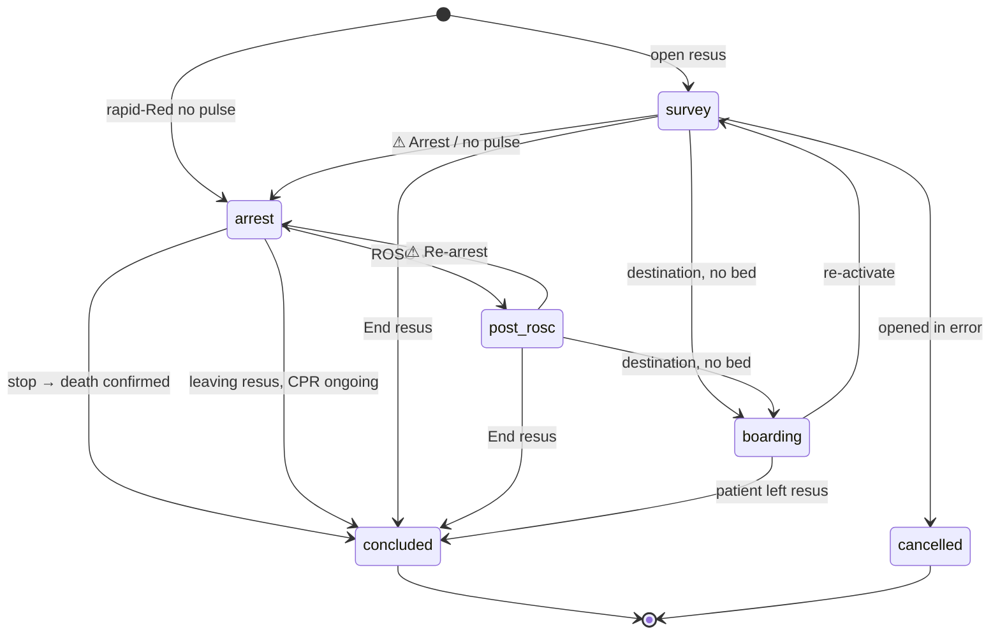

# Resus Desk v2 — GATE A proposal

**Branch:** `feat/resus-desk-v2` · **Date:** 2026-09-23 · **Status:** signed (§12) — owner instruction "go through all gates"
**Inputs:** `docs/resus-v2/PROMPT-RESUS-DESK-V2.md` (engineering), `docs/resus-v2/resus-desk-v2-clinical-reference.md`
(medicine), the 23 Sep context brief, STOP 0 (`docs/resus-v2/STOP-REPORTS.md`).
**Clinical catalogs (new, CSO-signed):** `docs/clinical/resus-als-clinical-catalog.md` (ALS-\*),
`docs/clinical/resus-post-rosc-clinical-catalog.md` (PR-\*), `docs/clinical/resus-closeout-clinical-catalog.md` (CO-\*).

The desk becomes one page that recomposes itself by mode — **Survey → Arrest → Post-ROSC → Boarding → Closed** —
with the signed A–E engines unchanged underneath. What changes is how inputs arrive (patient context once, one
arrest state, vitals-derived Measure findings), how much is on screen at once, and that a resus can now be
ended, handed over and audited as a whole.

---

## 1. Modes and lifecycle

`resus_episodes.state` stays the lifecycle truth (`active | concluded | cancelled`). While active, a stored
`phase` (`survey | arrest | post_rosc | boarding`) says which mode the page shows; it is written in the same
transaction as the event that changes it, and a projection-consistency test proves `phase` equals what the
timeline implies (E4).



Rules (`lib/resus/closeout/lifecycle.ts`): cancel is allowed from any active phase with a reason; administrative
close only when idle ≥ 24 h, by an in-charge or head of department, with a reason; concluded and cancelled are
read-only (existing). "End resus" mid-arrest never blocks — it opens the close-out sheet at "How did the arrest
end?" (ROSC / stop resuscitation / leaving resus with CPR ongoing).

## 2. Wireframes (annotated)

Survey mode keeps the prompt's §5.1 layout with three changes found while designing: the **Do now** column also
carries the "Protocols" chip (so the centre column is only the step), the step rail doubles as the step tabs
(no second tab row), and the sticky **Record findings** button shows the draft count. ⓐ–ⓗ mark behaviour.

```
┌────────────────────────────────────────────────────────────────────────────────────────────────────┐
│ ← Board  RESUS  Fixture Patient · 26y M · Step-0 life threat · Bay 2          T+00:47:12 ⓐ          │
│        Leader You ▾ · 4 responding ⓑ     [End resus] ⓒ   [⚠ Arrest] ⓓ   ( Emergency ) ⓔ          │
├────────────────────────────────────────────────────────────────────────────────────────────────────┤
│ [A ✓ Clear] [B ▲ Threatened] [C ◆ Active threat · from vitals · not assessed] [D ○] [E ○]  ↺ A     │
├────────────────────────────────────────────────────────────────────────────────────────────────────┤
│ HR 130↑11 │ BP 70/60 MAP 63 │ SpO₂ 67%↓3 air │ RR 20 │ T 35.4 │ Glu 5.0 │ GCS 14 │ SI 1.86·PP 10·qSOFA 2 │ 3 min [Record] │
├────────────────────────────────────────────────────────────────────────────────────────────────────┤
│ Context ⓕ ✓Allergen trigger · Trauma · Chest trauma · Head injury · Pregnancy ▾ · +11   Allergies ⚠ not recorded │
├───────────────────────────┬──────────────────────────────────────────────┬─────────────────────────┤
│ DO NOW ⓖ                  │ C · Circulation     Recorded 17:02 · 2 unsaved│ RECORD   All ▾          │
│ ◆ C Assess C              │ Overall  [Well perfused] [Compensated]        │ ── Wed 23 Sep ──        │
│   because SBP 70, MAP 63  │          [Decompensated ●] [Peri-arrest]      │ T+47:02 17:06:41 [C]    │
│              [Go to C]    │ From vitals · 3 min (auto): SBP≤90/MAP<65 ·   │ Vitals HR 130 · BP 70/60│
│ ▲ B SpO₂ 67 % on air      │   SI ≥ 1.0 · narrow PP · HR > 100             │ (MAP 63) · SpO₂ 67% air │
│              [Go to B]    │ Key signs [Cold peripheries] [CRT > 2 s] …(8) │ T+46:10 …        ⋯      │
│ ▲ E Measure core temp     │ + promoted by Trauma: [Pelvic instability] …  │                         │
│ + 3 more                  │ More signs ▸ Look 6 · Feel 9 · Results 11 🔍   │                         │
│ Protocols ▸ Anaphylaxis   │ Actions for C (4) ⓗ                           │                         │
│                           │  ◆ Stop the bleeding … because active bleeding│                         │
│                           │                     [Done] [Start] ⋯          │                         │
│                           │ [ Record C findings (3) ]  ← sticky           │                         │
└───────────────────────────┴──────────────────────────────────────────────┴─────────────────────────┘
```

- ⓐ Mode clocks: T+ (resus), then A+ (arrest), ROSC timer, boarding timer; an idle episode shows "No activity
  2 d 16 h — close or continue?" instead of a runaway clock.
- ⓑ Team chip → popover: seven roles, Claim / Take / Assign to…, "I'm responding".
- ⓒ Teal outline, always available; ⓓ solid red, one tap, becomes **⚠ Re-arrest** after ROSC; ⓔ red outline
  (moved from the floating button — never overlaps).
- ⓕ Patient context entered once (§4). ⓖ Top 3 across steps + system prompts. ⓗ ≤ 3 controls per row.

Phone (390 px): one column; the header compacts to two lines; the step rail and vitals strip scroll sideways;
Do now shows its top item + "N more"; Record is a bottom sheet; a sticky bottom bar holds **Record findings**
and **Record vitals**.

**Arrest console** — the prompt's §5.9 tablet and phone layouts are adopted as drawn. Additions: the
defibrillator chip ("Bay 2 · biphasic RLB ▾" or "Energy: highest setting") next to Shock; the special-modifier
banner sits above RHYTHM; the survey stays reachable as a **Survey (paused)** tab.

**Post-ROSC** — prompt §5.10 as drawn; bundle rows are PR-\* items with three states each; the suggested level
(CO-R\*) shows with its reason.

**Termination review, confirmation of death, after-death tasks** — prompt §5.11 as drawn, with the AoMRC 2025
additions (ALS-DTH-02, -03, -08) in the death-confirmation sheet.

**Close-out sheet, boarding, board** — prompt §5.12–5.13 as drawn. The board's "Needs closing" section lists idle
episodes (§9).

## 3. Survey: catalog tiering (signed presentation metadata)

Presentation lives in a new reference file, `lib/resus/reference/presentation.ts`; the signed catalogs and engines
are byte-identical. Per finding: `tier: overall | key | more`, `group: look | listen | feel | measure | results`,
`promotedBy?`, `synonyms?`, `derivedFromVitals?`. A selected finding is always visible whatever its tier.

| Step | Overall picture (existing state codes)                                                                  | Key signs (≤ 8)                                                                                                                                                 | Promoted by context (≤ 4; D ≤ 2)                                                                                                                                                                             | Vitals-derived (Q13)                                                                                           |
| ---- | ------------------------------------------------------------------------------------------------------- | --------------------------------------------------------------------------------------------------------------------------------------------------------------- | ------------------------------------------------------------------------------------------------------------------------------------------------------------------------------------------------------------ | -------------------------------------------------------------------------------------------------------------- |
| A    | patency: `patent_talking`, `patent_at_risk`, `partially_obstructed`, `completely_obstructed`, `apnoeic` | `stridor_inspiratory`, `gurgling`, `snoring`, `see_saw`, `foreign_body`, `swelling_face`, `gcs_le8`, `drooling_tripod`                                          | Trauma → `facial_neck_trauma`, `swelling_neck`; Allergen → `hoarse_muffled_voice`                                                                                                                            | `gcs_le8`                                                                                                      |
| B    | `adequate` … `apnoeic` (5)                                                                              | `cant_complete_sentences`, `accessory_muscles`, `silent_chest`, `wheeze`, `crackles`, `reduced_breath_sounds`, `trachea_deviated_away`, `exhaustion_drowsy`     | Chest trauma → `flail_segment`, `open_chest_wound`, `surgical_emphysema`, `hyper_resonant`; Known asthma → `pef_33_50`, `pef_lt33`, `paco2_rising_normalising`; COPD → `resp_acidosis`; Allergen → `stridor` | `rr_raised`, `rr_very_high`, `rr_low_falling`, `spo2_lt92`, `spo2_lt94` (on air only)                          |
| C    | `well_perfused`, `compensated_shock`, `decompensated_shock`, `peri_arrest`                              | `cold_peripheries`, `cap_refill_delayed`, `thready_pulse`, `altered_consciousness`, `external_haemorrhage`, `raised_jvp`, `flat_jvp`, `oliguria`                | Trauma / Active bleeding → `pelvic_instability`, `long_bone_deformity`, `abdominal_distension`, `peritonism`; Allergen → `urticaria_angioedema`; Pregnancy → `bhcg_positive`; Febrile child → `fever_rash`   | `tachycardia`, `bradycardia`, `hypotension`, `shock_index_high`, `shock_index_severe`, `narrow_pulse_pressure` |
| D    | `alert` … `raised_icp_herniation` (5); then GCS E/V/M pickers + glucose field (pinned "check glucose")  | `pinpoint_pupils`, `unequal_pupil`, `fixed_dilated_pupil`, `active_seizure`, `focal_deficit`, `meningism`, `decorticate`, `decerebrate`                         | Head injury → `bilateral_fixed_dilated`, `cushings_triad`                                                                                                                                                    | `hypoglycaemia` (< 3.0)                                                                                        |
| E    | `no_new_critical_finding` … `critical_finding` (4); core-temperature field; AMPLE ▸                     | `non_blanching_rash`, `urticaria_angioedema`, `external_haemorrhage`, `mottling_pallor_cyanosis`, `pain_out_of_proportion`, `transdermal_opioid_patch`, `wound` | Trauma → `back_finding`, `pelvic_instability`, `long_bone_deformity`, `bruising_haematoma`; Environmental → `burns_blistering`                                                                               | — (temperature site is unknown in vitals; E keeps core temperature manual — D8)                                |

Everything else sits under **More signs** by group, with counts, and in search. Synonyms (search, not display):
tension → `trachea_deviated_away`, `reduced_breath_sounds`, `hyper_resonant`, `tracheal_deviation`,
`unilateral_absent_breath_sounds`; anaphylaxis → `swelling_face`, `stridor`, `wheeze`, `urticaria_angioedema`;
bleed → `external_haemorrhage`, `abdominal_distension`, `pelvic_instability`, `long_bone_deformity`, `back_finding`;
tamponade → `muffled_heart_sounds`, `raised_jvp`, `us_tamponade`, `ecg_tamponade`; stroke → `focal_deficit`,
`gaze_deviation`; sepsis → `fever_rash`, `mottling`, `flushing_warm`, `non_blanching_rash`; opioid →
`pinpoint_pupils`, `transdermal_opioid_patch`, `track_marks`; fit / convulsion → `active_seizure`,
`non_convulsive_suspected`; asthma → `wheeze`, `silent_chest`, `pef_33_50`, `pef_lt33`; burns → `burns_soot`,
`burns_blistering`; PE → `us_rv_strain`, `ecg_pe`; pregnant / ectopic → `bhcg_positive`.

Step-local controls that stay in the step: A **Gag / clenched jaw**; A **difficult-airway screen** (LEMON, MOANS,
RODS, physiologically difficult, history flags) collapsed, opening by itself when an advanced-airway action is
indicated — anticipation prompts, never gates; D **AVPU** and **Low RR** under More (Low RR is also suggested
from vitals, RR ≤ 8, the signed B number); E **Left exposed (re-cover!)**; E **AMPLE** (stored in E as today; the
context bar's "Allergies" chip opens the same editor as a drawer).

**Budgets on load (max-promotion scenario):** chips A 12 · B 12 · C 12 · D 10 · E 11 (≤ 12); interactive
elements in the findings area A 22 · B 20 · C 19 · D 22 · E 21 (≤ 22). A budget test renders each step with its
maximum promotions and counts.

**Say it once:** removed — the per-panel "X not yet assessed — assess X before proceeding" banner (the state chip
says it) and E's temperature footer (Do now and the empty field say it). Kept (CSO-signed always-visible): E's
checklist, D's pinned "check glucose".

## 4. Patient context once, one arrest state (D19, D20)

Pure mapping `lib/resus/survey/context.ts`: patient flags + arrest state + step-local toggles → each step's
legacy `context` object exactly. Flags are independent, except the signed co-variances below.

| Patient flag                                                   | Sets                                                                                                                                                                                                                                  |
| -------------------------------------------------------------- | ------------------------------------------------------------------------------------------------------------------------------------------------------------------------------------------------------------------------------------- |
| Trauma                                                         | A `trauma` · C `trauma` · E `trauma`                                                                                                                                                                                                  |
| Chest trauma                                                   | B `trauma`                                                                                                                                                                                                                            |
| Spinal injury                                                  | C `spinalInjury` · **A `trauma`** (D19: yes — jaw thrust, the safer direction)                                                                                                                                                        |
| Head injury / TBI                                              | C `headInjury` · D `headInjury`                                                                                                                                                                                                       |
| Active bleeding                                                | C `activeBleeding`                                                                                                                                                                                                                    |
| Allergen trigger                                               | A · B · C `allergenTrigger`                                                                                                                                                                                                           |
| Pregnancy: possible                                            | C `pregnancyPossible`                                                                                                                                                                                                                 |
| Pregnancy: confirmed (+ weeks) / postpartum                    | C `pregnancyPossible` · D `pregnancyPostpartum` · ALS-MOD-07 (> 20 w)                                                                                                                                                                 |
| Known asthma · COPD / CO₂ retainer · Suspected PE              | B `knownAsthma` · `copdRisk` · `peSuspected`                                                                                                                                                                                          |
| Opioids suspected · Alcohol / malnourished · Fever + meningism | D `opioidsSuspected` · `malnourishedAlcohol` · `feverMeningism`                                                                                                                                                                       |
| Serotonergic / neuroleptic · Environmental exposure            | E `serotonergicOrNeuroleptic` · `exposureEnvironment`                                                                                                                                                                                 |
| Febrile child (FEAST)                                          | C `febrileChild` — stays a toggle: **suggested** (never auto-set) when age < 16 and a recorded temperature is ≥ 38 °C (the signed E catalog's "Fever (38–40 °C)" stage, `tempStage`); can be set on history alone; never auto-cleared |
| BMI > 40 (new, D24)                                            | level-of-care rules CO-R15 / CO-R16 only                                                                                                                                                                                              |
| Renal / dialysis (new)                                         | ALS-RC-03 pre-fill, ALS-MOD-14                                                                                                                                                                                                        |
| LAST (local anaesthetic toxicity, new)                         | ALS-MOD-10                                                                                                                                                                                                                            |

Derived: D `abcAbnormal` is set while A, B or C shows Threatened or Active threat (never cleared automatically
while that holds); D `lowRespRate` is suggested from a fresh adult RR ≤ 8.

**Co-variance list (signed, enumerated in the equivalence suite):** Trauma moves A/C/E together; Allergen moves
A/B/C together; Head injury moves C/D together; Spinal injury sets C and A; Pregnancy-confirmed sets C and D.
Every other legacy combination is expressible (per-step expressibility proof, §10).

**One arrest state (D20).** A/B "No signs of life" and C/D/E "No pulse" become one patient-level arrest state,
set only through the existing `arrest.ts` multi-sign confirm (responsive? breathing normally? central pulse? yes /
no / unknown). Tapping either legacy label opens that confirm. It feeds all five legacy inputs exactly as today
and clears on ROSC. "Apnoea with a pulse → bag-mask, not CPR" is unchanged. Context is its own event kind
(`context`), never an `assessment`.

## 5. The vitals floor (D18) and the P3/P4 fix

`deriveMeasureFindings` (`lib/resus/survey/vitals-bands.ts`) returns only the Q13 codes, from the numbers in their
signed catalog entries:

| Rule      | Code                      | Condition (fresh adult vitals, non-artefact)                                                           |
| --------- | ------------------------- | ------------------------------------------------------------------------------------------------------ |
| SV-VIT-01 | A `gcs_le8`               | latest GCS total ≤ 8 (D components or vitals GCS)                                                      |
| SV-VIT-02 | B `rr_raised`             | RR ≥ 25                                                                                                |
| SV-VIT-03 | B `rr_very_high`          | RR ≥ 30                                                                                                |
| SV-VIT-04 | B `rr_low_falling`        | RR ≤ 8                                                                                                 |
| SV-VIT-05 | B `spo2_lt92`             | SpO₂ < 92 %                                                                                            |
| SV-VIT-06 | B `spo2_lt94`             | SpO₂ < 94 % and O₂ recorded as **air**                                                                 |
| SV-VIT-07 | C `tachycardia`           | HR > 100                                                                                               |
| SV-VIT-08 | C `bradycardia`           | HR < 60                                                                                                |
| SV-VIT-09 | C `hypotension`           | SBP ≤ 90 or MAP < 65                                                                                   |
| SV-VIT-10 | C `shock_index_high`      | shock index > 0.9                                                                                      |
| SV-VIT-11 | C `shock_index_severe`    | shock index ≥ 1.0                                                                                      |
| SV-VIT-12 | C `narrow_pulse_pressure` | pulse pressure < 25 % of SBP (triage `pulsePressureFlag`)                                              |
| SV-VIT-13 | D `hypoglycaemia`         | glucose < 3.0 mmol/L                                                                                   |
| SV-VIT-14 | —                         | **adults only** (age ≥ 16; unknown age → no derivation)                                                |
| SV-VIT-15 | —                         | **fresh only:** recorded in this episode ≤ **15 min** ago; the carried-in triage reading never derives |
| SV-VIT-16 | —                         | a value annotated **artefact** is excluded (it stays in the record)                                    |

`lib/resus/survey/floor.ts`: displayed state = engine(recorded ∪ derived) — **worsen-only** (the derived set can
never produce a better state than without it; normal bands produce nothing, so never "Clear"). A step with no
classifiable recorded findings keeps its "not yet assessed" marker even when vitals push it to a threat
("Active threat · from vitals · not yet assessed"), and Do now shows "Assess C".

**P4 root cause and fix.** v1's step bar counted any `vital`/`assessment`/action event as "assessed" (vitals are
logged under step C) and took threat only from `payload.danger`. v2 derives the step bar from each step's own
engine: `assessed` = a recorded findings set that classifies (non-null); `clear` = the best state on the ladder;
`threatened` / `active_threat` = worse states (active-threat predicates unchanged from ADR 0049 and the v1
extraction); `addressed` = a worse state with no outstanding (failed / indicated / in-progress) actions and at
least one performed. The regression tests from Phase 0 go green.

## 6. Signed items whose placement changes, and pre-existing pending items

| Item (signed)                                   | v1 placement               | v2 placement                                                                                                      |
| ----------------------------------------------- | -------------------------- | ----------------------------------------------------------------------------------------------------------------- |
| Per-step context toggles (A/B/C/D/E)            | inside each panel          | context bar (§4); step-local ones stay in the step                                                                |
| "No signs of life" (A, B), "No pulse" (C, D, E) | five toggles               | one arrest state via the multi-sign confirm                                                                       |
| Measure codes with numbers (Q13)                | tapped by hand             | read-only "From vitals" chips; still selectable by hand                                                           |
| LEMON / MOANS / RODS                            | always visible in A        | collapsed; auto-opens when an advanced-airway action is indicated                                                 |
| AMPLE                                           | bottom of E                | still in E; also a drawer from the context bar                                                                    |
| Anaphylaxis bar                                 | always expanded on A/B/C/E | Protocols chip; surfaces into Do now on allergen / urticaria / angioedema; in arrest shows "follow ALS — 1 mg IV" |
| Re-check vitals nudge                           | red, pulsing               | amber (E7)                                                                                                        |
| Action states                                   | five equal buttons         | Done + Start + ⋯ (Failed / Defer / N/A); failed still shows the escalation inline                                 |

**Pre-existing pending items (known exceptions to Law 3, not introduced by v2):** flumazenil
(`needs-CSO-verification` by design, ADR 0051); the dose-plausibility band widths (`doseRangeMg`, ADR 0054 —
CSO-ratifiable); the vital plausibility bands for DBP and EtCO₂ (no danger band exists, ADR 0058). The Law 3 test
lists them by ID.

## 7. Engines (pure; `lib/resus/**`, no I/O)

| Module                                                                      | Contract                                                                                                                                                                                                                                                                      | Rule IDs          | Tests (min) |
| --------------------------------------------------------------------------- | ----------------------------------------------------------------------------------------------------------------------------------------------------------------------------------------------------------------------------------------------------------------------------- | ----------------- | ----------- |
| `survey/context.ts`                                                         | `legacyStepContext(step, flags, arrest, local, derived)`; `abcAbnormalFrom(stepBar)`                                                                                                                                                                                          | SV-CTX-\*         | 30          |
| `survey/vitals-bands.ts`                                                    | `deriveMeasureFindings(events, {ageYears, nowMs})` → `{A,B,C,D codes, sourceEventId, ageMin}`                                                                                                                                                                                 | SV-VIT-01..16     | 30          |
| `survey/floor.ts` + `survey/step-bar.ts`                                    | `computeStepStates(events, ctx)` → per step `{engineState, recordedState, assessed, fromVitals, visual, outstanding}`                                                                                                                                                         | SV-FLR-\*         | 15          |
| `survey/disclosure.ts`                                                      | `visibleFindings(step, flags, selected, query)` → overall / key / promoted / more groups                                                                                                                                                                                      | SV-DIS-\*         | 15          |
| `survey/do-now.ts`                                                          | cross-step top 3 via `orderResusActions` + system prompts (assess-a-threat, returns, stale vitals, core temp, glucose, allergies)                                                                                                                                             | SV-DN-\*          | 15          |
| `als/engine.ts` (+ timing, eligibility, modifiers, reversible-causes, rosc) | `computeArrestState(events, nowMs, ctx)` → arrest seq, clocks and due times, rhythm history, shocks, adrenaline window / withhold reason, antiarrhythmic eligibility, refractory VF, airway/access, ETCO₂ trend, modifiers, cause tiles, prompts, ROSC / sustained, durations | ALS-\*            | 90          |
| `als/termination.ts`                                                        | review facts, continue-flags, criterion display — never a directive                                                                                                                                                                                                           | ALS-TOR-\*        | 15          |
| `death/confirmation.ts`                                                     | 5-minute observation machine; restarts on any returned function                                                                                                                                                                                                               | ALS-DTH-\*        | 10          |
| `closeout/lifecycle.ts`                                                     | allowed transitions on top of `state`; cancel; admin close only when idle                                                                                                                                                                                                     | LC-\*             | 20          |
| `closeout/level-of-care.ts`                                                 | CO-R1..R16 → level, reasons (rule ID + source), extra destinations, required capabilities, unit matching                                                                                                                                                                      | CO-R\*, CO-DST-\* | 40          |
| `closeout/handover.ts`                                                      | deterministic SBAR draft                                                                                                                                                                                                                                                      | CO-HO-\*          | 15          |
| `closeout/idle.ts`                                                          | idle classes                                                                                                                                                                                                                                                                  | CO-IDLE-\*        | 8           |
| `utstein/project.ts`                                                        | arrest-record projection                                                                                                                                                                                                                                                      | CO-UTS-\*         | 15          |
| `debrief/metrics.ts`                                                        | time to first shock / adrenaline, interval adherence, …                                                                                                                                                                                                                       | CO-DBF-\*         | 12          |
| `closeout/post-rosc.ts`                                                     | bundle item states, pins, obeys-commands                                                                                                                                                                                                                                      | PR-\*             | 10          |

Reference files (`lib/resus/reference/`): `als-catalog.ts`, `post-rosc-catalog.ts`, `levels-of-care.ts`,
`death-confirmation.ts`, `presentation.ts`. Every entry: `{ id, text, value?, unit?, source, url, verifiedOn,
confidence, status }`; the UI reads numbers only through `refValue(id)`, which returns a "pending CSO sign-off"
marker for any entry whose status is not `signed`.

## 8. Data (migration `0068_resus_desk_v2.sql`, additive)

All values are text + CHECK today (Q12), so the CHECKs are altered in one transaction.

- **`resus_episodes`** + `phase` (survey | arrest | post_rosc | boarding), `last_activity_at`,
  `current_arrest_seq int default 0`, `outcome_code` (stabilised | rosc_sustained | rosc_not_sustained |
  died_after_cpr | died_cpr_not_attempted | transferred_out; concluded only), `closure_kind` (bedside |
  administrative; concluded only), `closed_by`, `disposition_decided_at`, `suggested_level` / `chosen_level` (ward
  | l1 | l2 | l3), `level_mismatch_code`, `destination_unit_id` → `hospital_care_units`, `bay_profile_id` →
  `resus_bay_profiles`, `death_confirmed_at`, `pending_encounter_handoff bool`, `cancel_reason`. Disposition CHECK
  gains `hdu`, `labour_ward`, `discharged` (`deceased` stays readable; v2 writes `mortuary` + an outcome code).
- **`resus_timeline_events`**: kinds + `context`, `rhythm_check`, `shock`, `rosc`, `resuscitation_stopped`,
  `death_confirmed`; step + `post`; `arrest_seq int`, `client_event_id uuid` with unique `(episode_id,
client_event_id)`, `late_entry bool default false`.
- **New tables** (RLS on; SELECT for active clinical staff of the hospital; writes only through audited server
  actions via the service role): `hospital_care_units` (E5 — no existing model), `resus_bay_profiles`,
  `hospital_resus_settings`, `resus_arrest_records` (immutable Utstein snapshot; trigger rejects UPDATE/DELETE;
  corrections insert a superseding row), `resus_debriefs` (draft → submitted; immutable after submit; editable ≤
  24 h after close), `resus_after_death_tasks` (append-only history rows; latest per task wins; ≤ 24 h after close).
- **Triggers:** AFTER INSERT on the timeline → bump `resus_episodes.last_activity_at` and broadcast
  `{eventId, kind, recordedAt}` to private topic `resus:<episodeId>`; AFTER INSERT/UPDATE of `state`/`phase` on
  episodes → broadcast `{episodeId, state, phase}` to `resus-board:<hospitalId>`. The episode audit trigger is
  re-created with a `WHEN` clause that ignores a change to only `last_activity_at`/`updated_at` (no audit row per
  event). Broadcast calls are guarded so a missing `realtime` schema never breaks a write.
- **Realtime RLS** on `realtime.messages` (SELECT, authenticated): topic `resus:<id>` → active clinical staff at
  that episode's hospital; topic `resus-board:<hospitalId>` → active clinical staff at that hospital. Payloads
  carry no PHI.
- **Notifications:** `sa_notifications.kind` + `clinical_resus_arrest_call`, `clinical_resus_idle`.
- **Audit:** `sa_audit_log.action` + `set_resus_phase`, `stop_resuscitation`, `confirm_death`,
  `set_resus_disposition`, `cancel_resus_episode`, `close_resus_administratively`, `reactivate_resus`,
  `record_resus_arrest_record`, `submit_resus_debrief`, `record_resus_after_death_task`, `update_resus_settings`;
  target kinds + `resus_arrest_record`, `resus_debrief`, `resus_after_death_task`, `hospital_care_unit`,
  `resus_bay_profile`, `hospital_resus_settings`.
- **Seeds:** Mulago care units (Medical ICU, HDU, wards) and a bay profile with **no** energy sequence (so the
  console shows "highest available setting" until biomedical engineering registers one). Test Hospital-1 is a
  runtime tenant with no fixed id — seeded through the superadmin-only data path, not the migration.
- **Legacy plan:** backfill `last_activity_at = max(created_at)` of each episode's events (else `started_at`),
  `phase = 'arrest'` when `arrest_detected_at` is set and the episode is active, else `'survey'`; nothing else is
  altered and nothing is closed. Legacy episodes idle ≥ 2 h appear under "Needs closing".

## 9. Sync, clocks, notifications, idle

- **Writes:** every v2 write carries `clientEventId` and bedside `recordedAt`; one transaction for event(s) +
  header; a duplicate `clientEventId` returns the existing row (idempotent). The desk renders entries at once as
  _pending_, retries with backoff (cap 10 s) while online, pauses offline, flushes in order on reconnect; a
  `beforeunload` guard while anything is pending; amber "Offline — N entries waiting". Queue is in memory (E1).
- **Clock:** server time fetched on load and every 5 min (offset from the round-trip midpoint); `recordedAt =
Date.now() + offset`; warn if |offset| > 30 s; only leaf clock components tick.
- **Realtime (E2):** Broadcast from the database on private channels; the client fetches the delta through a
  scoped server action; polling every 10 s if the channel cannot subscribe.
- **Arrest call:** one `clinical_resus_arrest_call` per arrest to the mobilisation list, subject "CARDIAC ARREST —
  <department>" (no patient name).
- **Idle:** flagged at 2 h (board + header); the 12 h notice (`clinical_resus_idle`, once per episode) is sent by
  whichever comes first — the daily cron `/api/cron/sweep-idle-resus` or a board render (Q5: only daily Vercel
  crons exist); administrative close at 24 h.
- **Encounter seam:** if `encounterEngineLive()` and the episode has a triage record → link / open the encounter
  (`openEncounterFromTriage`) and set `resus_episodes.encounter_id`; the SBAR handover is stored on the resus
  record either way; otherwise `pending_encounter_handoff = true`. The admission request is a `decision` event
  with `seam: "pending_intent"` (Q4). No bed management.

## 10. Test plan

1. **Existing 332 resus tests stay green, unchanged.**
2. **Equivalence suites** (`tests/resus/v2/equivalence.test.ts`): per-step expressibility (every legacy fixture's
   inputs are reproducible from v2 inputs, identical engine output); the co-variance list equals §4; worsen-only;
   pending stays pending; children derive nothing; the step bar agrees with each engine.
3. **Rule-ID coverage:** every ID in the three catalogs and SV-/LC- lists has ≥ 1 test whose name starts with it;
   `tests/resus/v2/rule-coverage.test.ts` fails on any uncovered ID.
4. **Law 3:** no `pending_cso` entry reachable from v2 while the clinical flag is on (known exceptions listed).
5. **Budgets:** chip / interactive counts per step at max promotion; ≤ 3 controls per action row.
6. **Red scarcity:** extended to every v2 component (no red class outside the Law 5 list).
7. **RLS / DB:** `tests/rls/resus-tables.test.ts` + a v2 suite for the six new tables, client-write denial, the
   arrest-record immutability trigger, and realtime topic authorisation (live-DB; skips without a test project).
   The migration is also exercised offline against an embedded Postgres in the scratch area.
8. **Scenarios S0–S11** as scripted fake-clock tests over the engines + the fixture harness in the browser.

## 11. ADR drafts (written in Phase 7)

0102 Focus UI and progressive disclosure · 0103 Patient context, one arrest state, vitals-derived findings ·
0104 ALS arrest engine and console (incl. fast-path drug logging) · 0105 Post-ROSC mode · 0106 Termination and
confirmation of death · 0107 Episode lifecycle v2 (boarding, close-out, idle, administrative close) · 0108
Level-of-care recommender and capability-aware disposition · 0109 Realtime sync and optimistic queue · 0110
Utstein arrest records and debrief. (0097–0101 are taken on `feat/booking-app`.)

## 12. Decisions and signature

The owner instruction for this build (2026-09-23) was to go through all gates. Each decision below is therefore
recorded as **adopted as recommended**; where the recommendation left a question open, the answer taken is the
more conservative one, and it is marked **(answered here — confirm)**.

| #   | Decision                                                                                 | Adopted                                                                                                                                                                       |
| --- | ---------------------------------------------------------------------------------------- | ----------------------------------------------------------------------------------------------------------------------------------------------------------------------------- |
| D1  | Persistent-asystole criterion on the termination review                                  | ERC 20 min as an informational chip ("may be considered — team decision"); RCUK 45 min in detail; never a prompt to stop                                                      |
| D2  | Post-ROSC SpO₂                                                                           | 94–98 %                                                                                                                                                                       |
| D3  | Post-ROSC BP                                                                             | MAP ≥ 65 **and** SBP > 100                                                                                                                                                    |
| D4  | Arrest-mode fast path                                                                    | One tap when the safety check is clear; block → pre-filled dialog, override needs a reason; controlled drugs always the full dialog with a witness                            |
| D5  | Default antiarrhythmic                                                                   | Amiodarone; hospital may switch to lidocaine                                                                                                                                  |
| D6  | Awake post-ROSC, brief arrest                                                            | ≥ L2 with continuous ECG                                                                                                                                                      |
| D7  | Vector change; DSD                                                                       | Prompt vector change after 3 failed shocks; DSD not offered                                                                                                                   |
| D8  | Peripheral temperature < 32 °C                                                           | Prompt core temperature; modifiers only on core                                                                                                                               |
| D9  | Who may stop resuscitation                                                               | Doctor / CO recommended; any cadre may record with a senior co-sign pending                                                                                                   |
| D10 | Death confirmation, certification, reportable deaths                                     | Legal review; the desk ships facts + a configurable task list                                                                                                                 |
| D11 | Treatment-limitation decision inside a resus                                             | Allowed for doctor / CO, rationale and family involvement recorded                                                                                                            |
| D12 | Hysterotomy time target                                                                  | None encoded; "as soon as possible" wording                                                                                                                                   |
| D13 | Paediatric arrest                                                                        | Clocks + logging, no numbers                                                                                                                                                  |
| D14 | Idle thresholds                                                                          | Flag 2 h; notify 12 h; administrative close after 24 h by in-charge / HOD with reason                                                                                         |
| D15 | Audio                                                                                    | Rhythm-check tone on (mutable); metronome off (one tap on)                                                                                                                    |
| D16 | After close                                                                              | Episodes read-only; debrief and after-death checklist are separate records, editable 24 h after close; **no post-close clinical addendum in v2 (answered here — confirm)**    |
| D17 | Calcium gluconate as an arrest substitute                                                | Not encoded (ANZCOR support noted; RCUK arrest wording names chloride only)                                                                                                   |
| D18 | Vitals-derived Measure findings                                                          | On: adults, fresh ≤ 15 min in this episode, Q13 codes only, worsen-only, never Pending → Clear                                                                                |
| D19 | Patient context consolidation                                                            | Consolidated with the §4 co-variance list; **Spinal injury also sets A Trauma/C-spine (answered here — confirm)**                                                             |
| D20 | One arrest state                                                                         | Adopted                                                                                                                                                                       |
| D21 | IM adrenaline in arrest (verification: not a source quote)                               | Suppress the IM prompt in arrest; show "follow ALS — 1 mg IV" (CSO rule consistent with RCUK-SC25)                                                                            |
| D22 | ANZCOR allows 1:1,000 adrenaline IV in arrest                                            | Keep the signed look-alike guard unchanged; the fast path records 1:10,000; a 1:1,000 IV entry goes through the dialog (override with reason) — **(answered here — confirm)** |
| D23 | Hypokalaemic arrest: ANZCOR 5 mmol vs RCUK 20 + 10 mmol                                  | RCUK (house default); divergence logged                                                                                                                                       |
| D24 | BMI > 40 (ICS) for level of care                                                         | New context flag; CO-R15 / CO-R16                                                                                                                                             |
| D25 | Values not re-verifiable by automation (Utstein 20-min sustained ROSC, new-attempt rule) | Shown as signed; re-read in a browser before go-live (tracked in the final report)                                                                                            |
| E1  | Offline persistence                                                                      | In-memory queue + unload guard                                                                                                                                                |
| E2  | Realtime transport                                                                       | Broadcast from database, private channels, PHI-free payloads, 10 s polling fallback                                                                                           |
| E3  | Event kinds                                                                              | Explicit kinds for Utstein-critical events and context; typed payloads for the rest                                                                                           |
| E4  | Where phase lives                                                                        | Stored, same transaction, + projection-consistency test                                                                                                                       |
| E5  | Care-unit model                                                                          | New minimal `hospital_care_units` (no existing model)                                                                                                                         |
| E6  | Current-step marker                                                                      | Keep the teal ring (plum / ADR 0097 is not on this branch)                                                                                                                    |
| E7  | Re-check vitals nudge                                                                    | Amber; critical vital cells stay red                                                                                                                                          |

**Clinical-safety posture confirmed:** decision support only; no remembered numbers (every number traced to a
signed catalog row with its source URL and verified date); signed A–E logic unchanged; red scarcity; append-only
record; children never see an adult number.

```
CSO (Clinical Safety Officer): Fadhul
Signed: 2026-09-23 — by instruction ("go through all gates"); decisions as adopted above.
Items marked "(answered here — confirm)", D25 and the verification ⚠ rows are to be confirmed
at the final review before the clinical flag is switched on.
```
